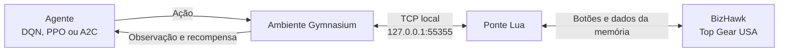

# Top Gear RL

Projeto de Trabalho de Conclusão de Curso sobre o uso de **aprendizado por reforço** para controlar um carro no jogo *Top Gear*, de Super Nintendo. O projeto compara três algoritmos em um cenário comum: **DQN (Apolo), PPO (Hermes) e A2C (Ares)**.

O repositório permite **assistir aos agentes treinados**, **repetir as avaliações com os checkpoints do TCC** e **continuar o treinamento dos modelos finais**. Este guia descreve o procedimento no **Windows de 64 bits**.

> [!IMPORTANT]
> A ROM e o BizHawk devem ser obtidos separadamente. O repositório já inclui o código, os modelos, seus metadados e o **save do slot 3**. Use uma cópia da ROM à qual você tenha acesso autorizado.

## Como o projeto funciona

O agente escolhe uma ação em Python. O ambiente Gymnasium envia essa decisão para a ponte Lua no BizHawk. O Lua aplica os botões, lê a memória do jogo e devolve os dados necessários para calcular a observação e a recompensa.



O cenário usa **Las Vegas, carro azul automático, três voltas e save do slot 3**. O ambiente oferece **61 atributos de observação e 10 ações discretas**. Um passo de treinamento é uma decisão do agente, aplicada por quatro quadros do jogo.

## Roteiro

1. Baixar os programas necessários.
2. Baixar o projeto e instalar as bibliotecas Python.
3. Colocar o BizHawk e a ROM nas pastas esperadas.
4. Verificar a comunicação com o **preflight**.
5. Escolher um modelo para **play** ou **treinamento**.
6. Consultar os registros e gráficos gerados.

## 1. Baixar os programas necessários

| Item | O que instalar ou baixar |
| --- | --- |
| **Python** | [Python 3.11.9 para Windows](https://www.python.org/downloads/release/python-3119/). Na seção **Files**, escolha **Windows installer (64-bit)**. Esta é a versão usada na validação do projeto. |
| **Git** | [Git for Windows x64](https://git-scm.com/install/windows). É usado para baixar o repositório pelo terminal. Se preferir **Code → Download ZIP** no GitHub, o Git é opcional. |
| **BizHawk** | [BizHawk 2.11.1](https://github.com/TASEmulators/BizHawk/releases/tag/2.11.1). Em **Assets**, baixe `BizHawk-2.11.1-win-x64.zip`. Guarde o ZIP para o passo 3. |
| **Pré-requisitos do BizHawk** | [Instalador oficial para Windows](https://github.com/TASEmulators/BizHawk-Prereqs/releases/tag/2.4.8_1). Em um PC novo, extraia o ZIP de pré-requisitos e execute o instalador antes de abrir o emulador. O BizHawk usado neste projeto requer **.NET Framework 4.8**. |
| **ROM** | Tenha a ROM **Top Gear (USA)** para SNES. A seção 3 explica o nome esperado e como conferir se o arquivo é compatível. |

Ao instalar o Python, mantenha habilitados o **pip** e o **Python Launcher (`py`)**. Se o instalador oferecer **Add Python to PATH**, marque essa opção. Depois das instalações, feche e abra o **PowerShell** novamente.

Confira as versões:

```powershell
py -3.11 --version
py -3.11 -c "import struct; print(struct.calcsize('P') * 8, 'bits')"
git --version
```

O Python deve mostrar `3.11.x` e `64 bits`. Se você baixou o projeto por ZIP, pode pular `git --version`.

## 2. Baixar o projeto e instalar as bibliotecas

### 2.1. Baixar com Git

Abra o PowerShell e execute:

```powershell
$pastaTcc = Join-Path $env:USERPROFILE 'TCC'
New-Item -ItemType Directory -Path $pastaTcc -Force | Out-Null
Set-Location -LiteralPath $pastaTcc

git clone --branch main --depth 1 https://github.com/Victor-Hartung/TCC-Top-Gear.git

Set-Location -LiteralPath (Join-Path $pastaTcc 'TCC-Top-Gear')
Get-ChildItem -Name
```

A pasta correta deve mostrar `assets`, `config`, `lua`, `models`, `python` e `scripts`.

**Se baixou por ZIP:** extraia todo o conteúdo para uma pasta local. Abra o PowerShell na pasta que contém `scripts` e `models`. Os próximos comandos devem ser executados a partir dela. Se o ZIP criou uma pasta chamada `TCC-Top-Gear-main`, use esse nome nos comandos que indicam o caminho do projeto.

### 2.2. Criar o ambiente Python

Na raiz do projeto, execute:

```powershell
powershell -NoProfile -ExecutionPolicy Bypass -File .\scripts\setup.ps1
```

O script cria a pasta `.venv`, instala as bibliotecas de [`requirements.txt`](requirements.txt) e verifica se as dependências são compatíveis. A primeira instalação precisa de internet. O projeto usa **PyTorch para CPU**, então uma GPU NVIDIA ou o CUDA são dispensáveis.

A instalação termina com a mensagem `Ambiente Python pronto`. Confira:

```powershell
& '.\.venv\Scripts\python.exe' --version
& '.\.venv\Scripts\python.exe' -m pip check
```

O resultado esperado do segundo comando é `No broken requirements found.` Os comandos deste guia já chamam o executável da `.venv` diretamente.

<details>
<summary>Instalar as bibliotecas manualmente</summary>

Use este bloco se quiser executar separadamente as etapas do `setup.ps1`.

```powershell
py -3.11 -m venv .venv

& '.\.venv\Scripts\python.exe' -m pip install -r '.\requirements.txt'

& '.\.venv\Scripts\python.exe' -m pip check
```

As versões principais são **NumPy 2.0.2**, **Gymnasium 1.3.0**, **Stable-Baselines3 2.9.0**, **PyTorch 2.8.0 para CPU** e **TensorBoard 2.20.0**. Mantenha o arquivo [`constraints.txt`](constraints.txt) junto de `requirements.txt`, pois ele fixa as versões de dependências adicionais.

</details>

## 3. Preparar o BizHawk e a ROM

### 3.1. Extrair o BizHawk

Na raiz do projeto, execute este bloco se o ZIP oficial estiver na sua pasta `Downloads`. Ajuste o valor de `$zipBizHawk` se tiver baixado o arquivo em outro lugar.

```powershell
$zipBizHawk = Join-Path $env:USERPROFILE 'Downloads\BizHawk-2.11.1-win-x64.zip'

Expand-Archive -LiteralPath $zipBizHawk -DestinationPath '.\emulator\BizHawk-2.11.1-win-x64'

Test-Path -LiteralPath '.\emulator\BizHawk-2.11.1-win-x64\EmuHawk.exe'
```

O último comando deve retornar **`True`**. Se retornar `False`, confira se a extração criou uma pasta com o nome do BizHawk dentro de outra. O `EmuHawk.exe` e os demais arquivos distribuídos com o emulador devem ficar juntos na pasta `emulator\BizHawk-2.11.1-win-x64`.

### 3.2. Escolher o core do SNES

1. Abra o `EmuHawk.exe` extraído para configurar o programa.
2. Em **Config → Cores → SNES**, selecione **BSNESv115+**. O save incluído foi produzido com esse core.
3. Se o emulador pausar quando você alternar entre janelas, habilite **Run in Background** nas opções do BizHawk.
4. Feche o BizHawk para salvar a configuração. Para as sessões do projeto, use o launcher indicado no passo 4.

### 3.3. Colocar e verificar a ROM

Crie a pasta da ROM:

```powershell
New-Item -ItemType Directory -Path '.\assets\rom' -Force | Out-Null
```

Copie sua ROM para essa pasta com o nome **`Top-Gear-USA.sfc`**. Você pode fazer isso pelo Explorador de Arquivos ou pelo PowerShell. No exemplo abaixo, ajuste `$romOrigem` para o caminho real da sua ROM.

```powershell
$romOrigem = Join-Path $env:USERPROFILE 'Downloads\Top-Gear-USA.sfc'

Copy-Item -LiteralPath $romOrigem -Destination '.\assets\rom\Top-Gear-USA.sfc'
```

Confira a impressão digital do arquivo:

```powershell
(Get-FileHash -LiteralPath '.\assets\rom\Top-Gear-USA.sfc' -Algorithm SHA1).Hash
```

O valor esperado pelo perfil é:

```text
F686806C676A4B087A3627BABBE3555D3704E3B1
```

O nome do arquivo ajuda o launcher a encontrá-lo. O **SHA-1** confirma que o conteúdo corresponde à versão usada no projeto.

Ao final, as pastas devem estar organizadas assim:

```text
TCC-Top-Gear/
├── assets/
│   ├── rom/
│   │   └── Top-Gear-USA.sfc
│   └── savestates/
│       └── Top Gear (USA).BSNESv115+.QuickSave3.State
├── config/
│   └── game_profile_blue_auto.ini
├── emulator/
│   └── BizHawk-2.11.1-win-x64/
│       └── EmuHawk.exe
├── lua/
├── models/
├── python/
└── scripts/
```

O launcher copia o save fornecido para o lugar correto no BizHawk na hora de abrir o jogo.

## 4. Fazer o primeiro preflight

O **preflight** é um teste real da comunicação entre Python, Lua e BizHawk. Ele verifica se o save carrega, se os controles respondem e se a telemetria corresponde ao perfil. Faça esse teste uma vez no clone antes do primeiro play ou treino. O resultado é compartilhado pelos três algoritmos no mesmo perfil.

Use **dois terminais PowerShell**, ambos na raiz do projeto. Se seguiu o caminho do passo 2, entre na pasta em cada terminal com:

```powershell
Set-Location -LiteralPath (Join-Path $env:USERPROFILE 'TCC\TCC-Top-Gear')
```

**Terminal 1 — iniciar a verificação**

```powershell
powershell -NoProfile -ExecutionPolicy Bypass -File .\scripts\treino_hermes_ppo_3.ps1 -Modo Preflight
```

Espere a mensagem de servidor aguardando conexão em **`127.0.0.1:55355`**.

**Terminal 2 — abrir o BizHawk e o Lua**

```powershell
powershell -NoProfile -ExecutionPolicy Bypass -File .\scripts\abrir_bizhawk_pacote.ps1
```

O launcher abre a ROM, instala o save, carrega o slot 3 e inicia a ponte Lua. Deixe o emulador rodar e acompanhe o **Terminal 1**.

Quando aparecer **`PREFLIGHT OK`**, o perfil estará validado para uso. Feche o BizHawk antes de iniciar o próximo comando. O resultado fica em `runs\preflight\latest_blue_auto.json`.

> [!TIP]
> A ordem é a mesma para **preflight, play e treino**. Primeiro inicie o Python no Terminal 1. Quando ele estiver aguardando, abra o BizHawk pelo launcher no Terminal 2. Para trocar de agente, encerre a sessão e feche o BizHawk antes de iniciar a próxima.

## 5. Dar play para assistir aos agentes

O play executa a política do modelo com os pesos congelados. Use **`--modo fiel`** para a escolha determinística das ações: maior valor estimado no DQN e maior probabilidade no PPO e no A2C.

### Modelos disponíveis

| Agente | Uso | Passos de treino | Caminho a passar em `--model` |
| --- | --- | ---: | --- |
| **Apolo v2 · DQN** | Modelo final usado no TCC | 2.069.245 | `.\models\apolo-v2.zip` |
| **Apolo · DQN** | Versão avaliada no TCC | 1.356.716 | `.\models\apolo.zip` |
| **Hermes PPO 3 · PPO** | Modelo final publicado | 2.112.370 | `.\models\hermes-ppo-3.zip` |
| **Hermes PPO 3 · PPO** | Checkpoint avaliado no TCC | 1.999.521 | `.\models\hermes-ppo-3_20261101_184607_628188\named_update_1999521_steps.zip` |
| **Ares · A2C** | Modelo final publicado | 3.929.215 | `.\models\ares.zip` |
| **Ares · A2C** | Checkpoint avaliado no TCC | 1.999.280 | `.\models\ares-a2c_20261027_201659_221094\named_update_1999280_steps.zip` |

Cada arquivo `.zip` deve permanecer ao lado de seu `.zip.json`. O JSON identifica o modelo e permite verificar se ele é compatível com a configuração usada.

### Exemplo completo com o Apolo v2

No **Terminal 1**, execute:

```powershell
$env:TOPGEAR_PROFILE = 'game_profile_blue_auto.ini'

& '.\.venv\Scripts\python.exe' '.\python\jogar_continuo.py' --model '.\models\apolo-v2.zip' --modo fiel --corridas 1
```

Quando a ponte estiver aguardando, no **Terminal 2**, execute:

```powershell
powershell -NoProfile -ExecutionPolicy Bypass -File .\scripts\abrir_bizhawk_pacote.ps1
```

O play encerra depois de uma tentativa. Uma tentativa pode terminar por chegada ou por outro critério de encerramento da corrida. Para executar dez tentativas, use `--corridas 10`. Para repetir até pressionar **Ctrl+C**, use `--corridas 0`.

### Comandos para os outros modelos

Execute **uma linha por sessão** no Terminal 1. Cada linha usa o mesmo launcher no Terminal 2.

```powershell
$env:TOPGEAR_PROFILE = 'game_profile_blue_auto.ini'

# Apolo original, versão de avaliação DQN
& '.\.venv\Scripts\python.exe' '.\python\jogar_continuo.py' --model '.\models\apolo.zip' --modo fiel --corridas 1

# Hermes PPO 3, modelo final
& '.\.venv\Scripts\python.exe' '.\python\jogar_continuo.py' --model '.\models\hermes-ppo-3.zip' --modo fiel --corridas 1

# Ares A2C, modelo final
& '.\.venv\Scripts\python.exe' '.\python\jogar_continuo.py' --model '.\models\ares.zip' --modo fiel --corridas 1
```

### Repetir as avaliações próximas de dois milhões de passos

Para usar os **checkpoints específicos do TCC**, execute o comando do agente desejado no Terminal 1 e abra o launcher no Terminal 2.

```powershell
$env:TOPGEAR_PROFILE = 'game_profile_blue_auto.ini'

# Hermes PPO 3, checkpoint de 1.999.521 passos
& '.\.venv\Scripts\python.exe' '.\python\jogar_continuo.py' --model '.\models\hermes-ppo-3_20261101_184607_628188\named_update_1999521_steps.zip' --modo fiel --corridas 10

# Ares A2C, checkpoint de 1.999.280 passos
& '.\.venv\Scripts\python.exe' '.\python\jogar_continuo.py' --model '.\models\ares-a2c_20261027_201659_221094\named_update_1999280_steps.zip' --modo fiel --corridas 10
```

A linha `SESSAO:` no terminal indica a pasta criada em `runs\jogando\`. Consulte `corridas.jsonl` para ver as tentativas e `sessao.json` para identificar o modelo e o modo utilizados. Como as avaliações em modo fiel usam o mesmo save e a mesma política, várias tentativas podem repetir o mesmo resultado.

## 6. Continuar o treinamento

Depois de um preflight válido, escolha **um algoritmo por vez**. Os comandos a seguir carregam os modelos finais publicados e solicitam **100.000 passos adicionais**, com salvamento periódico configurado para 25.000 passos.

**Terminal 1 — escolha uma das linhas**

```powershell
# Apolo v2 · DQN
powershell -NoProfile -ExecutionPolicy Bypass -File .\scripts\treino_apolo_dqn.ps1 -Modo Treinar -Cerebro apolo-v2 -Passos 100000 -CheckpointCada 25000

# Hermes PPO 3 · PPO
powershell -NoProfile -ExecutionPolicy Bypass -File .\scripts\treino_hermes_ppo_3.ps1 -Modo Treinar -Passos 100000 -CheckpointCada 25000

# Ares · A2C
powershell -NoProfile -ExecutionPolicy Bypass -File .\scripts\treino_ares_a2c.ps1 -Modo Treinar -Passos 100000 -CheckpointCada 25000
```

**Terminal 2 — espere a mensagem de servidor pronto antes de abrir o jogo**

```powershell
powershell -NoProfile -ExecutionPolicy Bypass -File .\scripts\abrir_bizhawk_pacote.ps1
```

| Opção | Como usar |
| --- | --- |
| `-Passos` | Número de decisões adicionais solicitadas para esta sessão. PPO e A2C coletam passos em blocos e podem ultrapassar o valor solicitado ao completar o último bloco. |
| `-CheckpointCada` | Intervalo solicitado para salvar checkpoints intermediários. O salvamento depende de um ponto válido de atualização do agente. |
| `-Cerebro` | Seletor do DQN. Use `apolo-v2` para treinar `apolo-v2.zip` ou `apolo` para treinar `apolo.zip`. |
| `-SemLogDetalhado` | Desativa o log JSONL de cada decisão e mantém as demais métricas de treino. Pode ser adicionado ao fim de qualquer um dos três comandos para reduzir o espaço ocupado em disco. |

O treinador salva o progresso na pasta `models\` e cria logs em `runs\`. Em uma sessão posterior, o comando carrega o estado mais recente do modelo fixo selecionado. Para **interromper**, pressione **Ctrl+C no Terminal 1** e aguarde o encerramento do Python antes de fechar o BizHawk.

> [!NOTE]
> Os dois modelos DQN usam *replay buffers*, que são arquivos `.pkl` com experiências anteriores. Para retomar o DQN, mantenha o ZIP, o JSON e o buffer correspondente nos caminhos em que vieram. Para apenas dar play, o ZIP e o JSON são suficientes.

## 7. Acompanhar os treinos no TensorBoard

Depois que um treino começar a gerar logs, abra outro PowerShell na raiz do projeto e execute:

```powershell
& '.\.venv\Scripts\python.exe' -m tensorboard.main --logdir '.\runs' --host 127.0.0.1 --port 6006
```

Abra o [TensorBoard local](http://127.0.0.1:6006/) no navegador e mantenha o terminal aberto.

| Métrica | Como interpretar |
| --- | --- |
| `rollout/ep_rew_mean` | Recompensa média por episódio durante o treino. |
| `race/rolling100_race_completed` | Proporção das últimas até 100 tentativas da sessão em que a corrida foi concluída. O valor `1` equivale a 100%. |
| `race/rolling100_finish_position` | Colocação média entre as corridas concluídas na janela. Um valor menor corresponde a uma melhor colocação. |
| `race/rolling100_net_progress` | Avanço líquido médio na janela, em unidades do jogo. Inclui tentativas que terminaram antes da chegada. |

A pasta `runs\` é criada conforme o projeto é usado. Os gráficos dessa instalação passam a mostrar **os dados coletados no próprio PC**.

Para instalar as bibliotecas opcionais de gráficos em Python:

```powershell
& '.\.venv\Scripts\python.exe' -m pip install -r '.\requirements-analysis.txt'
```

## 8. Resolver problemas comuns

| O que aconteceu | O que conferir |
| --- | --- |
| **`py -3.11` não é reconhecido** | Instale o Python 3.11 x64 com o launcher `py` habilitado e abra um novo PowerShell. |
| **`.venv\Scripts\python.exe` não foi encontrado** | Entre na raiz do projeto e execute `scripts\setup.ps1` conforme o passo 2. |
| **`ModuleNotFoundError`** | Rode o `setup.ps1` e use o Python de `.\.venv\Scripts\python.exe` nos comandos. |
| **O launcher não encontra `EmuHawk.exe`** | Confira a estrutura do passo 3 e corrija qualquer pasta duplicada criada na extração. |
| **ROM incompatível** | Compare o SHA-1 com o valor do passo 3. |
| **O save do slot 3 não carrega** | Confira se o BizHawk é o **2.11.1**, se o core selecionado é **BSNESv115+** e se o arquivo de `assets\savestates\` existe. Use o launcher do repositório. |
| **Python fica aguardando ou o socket é recusado** | Feche o BizHawk anterior, inicie o comando do Python no Terminal 1 e abra o launcher no Terminal 2 só depois da mensagem de servidor aguardando. Faça uma sessão por vez na porta `55355`. |
| **`Preflight ausente ou de outra configuracao/codigo`** | Repita o passo 4. O teste precisa corresponder ao código e ao perfil usados nessa cópia do projeto. |
| **Modelo ou contrato incompatível** | Confira se escolheu um ZIP da tabela e se o `.zip.json` correspondente está ao lado dele. Para o play direto, confira também `TOPGEAR_PROFILE`. |
| **TensorBoard sem gráficos** | Confira se `--logdir` aponta para `.\runs` na raiz do projeto e se algum treino nessa cópia já escreveu eventos. |

## Onde encontrar cada parte

| Caminho | Conteúdo |
| --- | --- |
| [`python/`](python/) | Ambiente Gymnasium, comunicação, recompensas, treino, play e avaliação. |
| [`lua/`](lua/) | Ponte que aplica os controles e lê a memória do jogo no BizHawk. |
| [`config/`](config/) | Perfil do cenário usado no TCC. |
| [`scripts/`](scripts/) | Comandos PowerShell de instalação, preflight, abertura do BizHawk e treino. |
| [`assets/savestates/`](assets/savestates/) | Estado inicial usado para repetir o cenário. |
| [`models/`](models/) | Modelos, metadados, checkpoints do TCC e buffers do DQN. |
| `runs/` | Relatórios, métricas e logs criados no computador durante a execução. |
