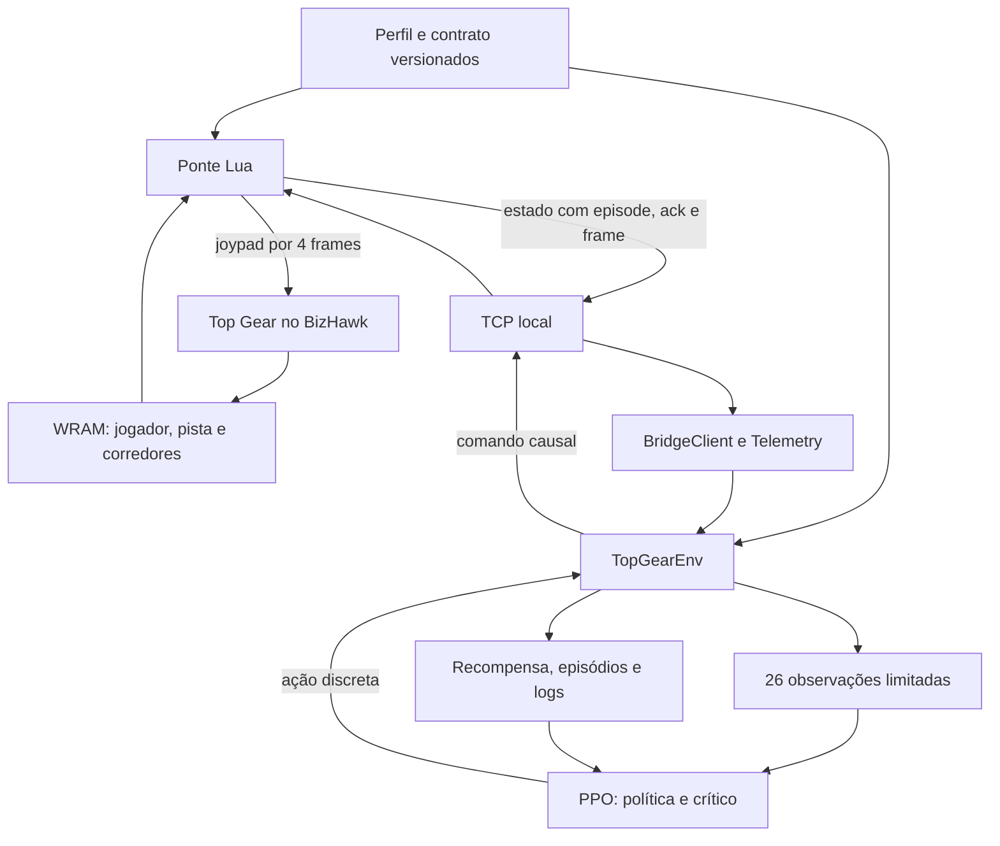

> Atualização de 15/09/2026 após regressão: perfil ativo **road_v5_race / recompensa 7**. Removidos os incentivos experimentais que favoreciam adiar turbo; sensor e observação de 61 entradas preservados. **207 testes offline passaram; preflight real e comparação sem aprendizado pendentes.** [Análise do vídeo, correção e próximos comandos](REGRESSAO_RITMO_TURBO_20260915.md). As instruções anteriores de treino longo são históricas e não são o próximo passo.

> Atualizacao de 15/09/2026: perfil ativo **road_v4_driving / recompensa 6**, para treino do zero. Custo contextual para soltar acelerador e novo criterio de uso util/reserva de turbo. **202 testes offline passaram; novo preflight real pendente por mudanca de contrato.** [Mudancas, evidencias e comando de 500 mil passos](TREINO_DO_ZERO_RITMO_TURBO.md). Avisos anteriores abaixo sao historicos.

> Atualizacao operacional de 14/09/2026: navegacao inspirada no piloto nativo P2 integrada; **61 features/schema 10, detector 3, ponte 5**. Identidade P2 por offsets e corredor com espacos livres. **Novo preflight real pendente**, antes de treino. Modelos de 47 entradas exigem migracao explicita do ator. [Implementacao, evidencias e comandos](NAVEGACAO_NATIVA.md). Avisos e contagens anteriores abaixo sao historicos.

> Revisao atual:47features/schema9,detector2,ponte4. Corrigida associacao entre carro e risco.136 testes offline passaram; repetir preflight real apos esta correcao. [Evidencias e procedimento](REVISAO_DETECTOR_20260912.md).

> Versao operacional atual: detector integrado experimental,47features/schema8,ponte4.134 testes offline passaram; novo preflight real pendente. Veja [contrato e comandos](INTEGRACAO_DETECTOR.md). Instrucoes anteriores abaixo sao historico e nao autorizam retomar modelos de26features.

> Atualizacao local 11/09/2026: suporte experimental a save na contagem regressiva, observacao schema 7 (26 features), recompensa v4 e reset sem avancar frames. Ver [largada e proximo teste](LARGADA_CONTAGEM.md). 116 testes offline passaram; novo preflight real pendente. Historico abaixo preservado.

# Revisão técnica e base v3.0 — Top Gear / PPO

Revisão: 9–10 de setembro de 2026. Objetivo: aprender pilotagem competitiva e buscar vitórias consistentes por reforço. **Não há evidência de que o agente atual saiba vencer.** A v3 é uma base consolidada de código, instrumentação e experimentos; o desempenho da nova política precisa ser medido no jogo.

## 1. Inventário, base vigente e classificação das evidências

O inventário foi feito antes das alterações. `INVENTORY.json` contém caminhos, tamanhos, hashes e índices dos arquivos disponíveis: 295 arquivos relevantes de sete árvores de código, 24 ZIPs históricos e 42 arquivos de upload. Ambientes virtuais/caches não foram tratados como fonte do projeto. Os arquivos enviados e as árvores anteriores ficaram preservados; as alterações estão somente na nova pasta v3.

A base vigente não era apenas a v2.0.28 original: era **v2.0.28 + correção de encerramento + avaliação determinística + experimento road_v1**. A árvore consolidada `road_reward_work/TCC-TopGear-RL_v2` foi comparada à v2.0.28 e às correções separadas. `archive/source` conserva os três pacotes relevantes; `archive/evidence` e `archive/models` separam evidências/modelos anteriores dos novos treinos. `CHANGES_VS_V2_0_28.json` registra alterações por arquivo. Documentos em `docs/history` são históricos, contêm afirmações superadas e não são instruções da v3.

Foram consultados os conteúdos presentes da conversa e os arquivos efetivamente disponíveis. Alguns anexos citados no início, como os primeiros CSVs de adversários, não existem mais entre os CSVs locais. Seus resultados constam dos relatos e documentos preservados, mas não foram apresentados como reexecutados. Não houve execução do EmuHawk Windows neste ambiente.

| Classe | O que significa nesta revisão | Exemplo |
|---|---|---|
| C — código/bytes | Leitura direta de fonte, configuração, ROM ou metadados | O sensor frontal usa volta absoluta e ignora distâncias negativas |
| T — teste automatizado | Código executado com entradas controladas | ACK errado encerra sessão; timeout não recebe bônus de chegada |
| V — BizHawk real, recebido | CSV/log/relato produzido no emulador do usuário | Vitória manual com lap 2→3 e final_rank −1→0 |
| I — inferência | Explicação consistente, não identificação causal comprovada | Recompensa desfavorecia exploração em comparação com parar |
| H — hipótese | Precisa de experimento discriminante | Um byte decrescente é o temporizador da corrida |
| D — descoberta pendente | Informação operacional ainda ausente | ID do carro que atingiu P1; origem do impacto |

Cada teste novo de Lua usa APIs simuladas quando não há BizHawk. Rodar a implementação Lua real nesse simulador verifica a lógica, mas não prova o significado da WRAM nem o comportamento do escalonador do emulador Windows.

## 2. Arquitetura atual e o fluxo completo

Responsabilidades concretas:

| Arquivo/componente | Função |
|---|---|
| `config/game_profile.ini`, `topgear_config.py` | Identidade da ROM, offsets, controles, escalas, tempo de ação, PPO e bloqueios estruturais |
| `lua/Top Gear (USA).lua` | Leitura WRAM, sensores, contagem de impactos por frame, joypad, reset de slot e resposta causal |
| `python/protocol.py` | Servidor TCP, framing, handshake, sequência/episódio, prazos e erros |
| `python/telemetry.py` | Tipos, invariantes, distinção término/chegada, vetor neural |
| `python/reward.py` | Componentes da recompensa; memória do máximo de progresso, melhor rank e imobilidade |
| `python/env_topgear.py` | Gymnasium: reset, step, flags terminal/truncado, info e validação do save |
| `python/recording.py`, `callbacks.py` | Logs antes do auto-reset, métricas e checkpoints/candidatos |
| `python/experiment.py` | Contrato, hashes, escrita atômica, compatibilidade e preflight |
| `train_hermes_ppo.py`, `avaliar_modelo.py` | Aprendizado e avaliação separados |
| `preflight_live.py`, `smoke_test_env.py`, `test_connection.py` | Testes reais curtos antes de investir em treino |
| `diagnostico_*.lua`, `analyze_*.py`, `audit_evidence.py`, `replay_rewards.py` | Descoberta, análise offline e reprodutibilidade |

VS Code é o editor/terminal. Quem se comunica com o emulador é o processo Python. A política recebe números da WRAM; não há CNN, captura de imagem ou detecção de sprites na observação atual. O arquivo da ROM é lido somente pelo emulador e por auditoria de bytes, não como observação da rede.

## 3. Comunicação e sincronização

**C/T:** Python abre servidor em **127.0.0.1:55355**; o BizHawk conecta ao iniciar com `--socket-ip/--socket-port`. O nome da API Lua `comm.socketServer...` não muda esse sentido da conexão. Há um único emulador/ambiente por porta. Não criar dois treinos simultâneos nessa porta.

Framing: comprimento decimal em bytes UTF-8, um espaço, depois exatamente o payload. Payloads continuam `TGACT2|...` e `TGSTATE2|...`; **protocolo 2, revisão da ponte 3**. TCP pode fragmentar ou juntar pacotes, portanto uma chamada `recv` não equivale a uma mensagem. Python recebe exatamente o tamanho declarado, limita a 1 MiB e rejeita prefixo inválido, texto inválido, controles e campos duplicados. Lua limita comandos a 4096 caracteres e exige inteiros não negativos até o limite exato de inteiros em double.

Handshake: Python envia `hello`, Lua retorna `ready` com mesmo episódio/ACK. Python verifica revisão, CRC do perfil, versão do protocolo, SHA-1 da ROM e tamanho WRAM. Adler32 identifica divergência acidental de perfil; não é autenticação criptográfica. Bytes CRLF são normalizados como LF nos dois lados. A ponte também registra versão reportada do BizHawk, sistema, PAL/NTSC e versão Lua quando a API está disponível; isso não equivale a identificar o nome/build do core SNES.

Cada comando tem sequência crescente; reset incrementa episódio. Duplicatas, regressões e episódios errados são recusados. Não há retry de uma ação que pode ter sido aplicada. Erro, desconexão, ACK incorreto ou delta de frames errado tornam a sessão inutilizável; pesos/logs são preservados, uma nova sessão começa por reset. A retomada não promete recuperar exatamente o frame da falha.

**C/V anterior:** a combinação que funcionou no BizHawk recebido foi manter recepção bloqueante entre comandos e avançar explicitamente com `client.unpause()` + `emu.yield()` até o frame desejado. Foi preservada. Voltar à pausa explícita antes de `frameadvance` reintroduziria o travamento já observado nas versões 2.0.16/17. A documentação da API recomenda a combinação usada para forçar avanço; ver [API Lua do BizHawk](https://tasvideos.org/Bizhawk/LuaFunctions).

Para uma ação, o Lua reaplica os botões a cada frame, conta impactos e exige exatamente um incremento de frame por iteração. Python exige delta total **4**. Entre comandos, o bloqueio do socket impede avanço espontâneo no modelo de execução validado anteriormente. O preflight inclui uma espera do Python e verifica que o delta continua exato. A v3 ainda precisa confirmar isso no emulador real.

Timeout normal: **10 s por resposta**, com prazo total da mensagem para impedir espera infinita por fragmentos. Inicialização: até **180 s para conectar** e outro prazo de inicialização para receber o HELLO pronto. O socket local não usa polling de `state.txt`/`action.txt`; arquivos antigos não comandam a v3. A API nativa Lua ainda pode bloquear até seu próprio timeout de socket; o código Python não promete controlar esse prazo interno. `close` limpa botões, responde, pausa e fecha. Erros Lua viram estado de erro quando a conexão permite transmitir; conexão rompida pode impedir a entrega do texto do erro.

Reset: carregar slot 1, confirmar retorno booleano, selecionar WRAM, zerar acumuladores, soltar todos os botões, avançar dez frames de estabilização, verificar comprimento/assinatura de curva, responder `reset_ok=1`. O frame pode diminuir no reset. Fora de reset, mudança do contador `load_events` invalida a sessão. No treino, a telemetria inicial deve coincidir com o preflight. Essa impressão digital reduz trocas silenciosas de save, mas não é hash de toda a RAM nem captura completa do RNG/core.

## 4. Observações: o que a rede realmente recebe

**Esquema 6, Box float32 com 26 valores.** Todos finitos e limitados; não há `VecNormalize`. `clip(x)` limita ao intervalo declarado. Escalas são definições do sensor, não conversão para unidades físicas.

| Feature, na ordem | Cálculo / intervalo |
|---|---|
| `speed_norm` | speed/16384, [−1,1]; inclui recuo e evita saturar os 13677 observados na vitória |
| `lateral_norm` | (lateral−centro)/32768, [−1,1] |
| `progress_norm` | progresso/comprimento, [0,1] |
| `lap_norm` | volta/total de voltas, [0,1] |
| `rank_norm` | rank/19, [0,1]; zero é melhor |
| `collision` | impacto/nível na janela da ação, 0/1 |
| `offtrack` | superfície diferente de asfalto, 0/1 |
| `surface_direction` | −1 esquerda, 0 pista, +1 direita |
| `fuel_norm` | valor bruto/65535, [0,1] |
| `nitro_norm` | cargas disponíveis/3, [0,1] |
| `turbo_active` | bit/decodificação de ativação, 0/1 |
| `gear_norm` | estado bruto/8, [0,1] com clip |
| `curve_current_norm` | curva atual/32, [−1,1] |
| `curve_ahead_512_norm` | curva em p+512/32, [−1,1] |
| `curve_ahead_1024_norm` | curva em p+1024/32, [−1,1] |
| `curve_ahead_2048_norm` | curva em p+2048/32, [−1,1] |
| `nearest_valid` | máscara de adversário frontal no alcance, 0/1 |
| `nearest_distance_norm` | distância/alcance, [0,1]; sem alvo = 1, máscara = 0 |
| `nearest_lateral_norm` | lateral adversário−P1, /32768, [−1,1] |
| `closing_rate_norm` | (distância anterior−atual)/(frames decorridos×64), [−1,1] |
| `lane_negative_risk` | 1−distância/alcance para faixa lateral negativa, [0,1] |
| `lane_center_risk` | mesmo cálculo para faixa relativa central |
| `lane_positive_risk` | mesmo cálculo para faixa lateral positiva |
| `surface_unknown` | distingue fallback da superfície medida, 0/1 |
| `closing_rate_valid` | 1 somente com mesmo ID e frames crescentes, 0/1 |
| `race_ended` | corrida encerrada, inclusive incompleta, 0/1 |

A derivada só compara o **mesmo carro**; trocar o alvo zera valor/máscara. Antes, o valor chamado closing_rate era mudança de distância dividida pelo alcance, sem unidade por frame. O novo sensor é uma derivada explicitamente dimensionada. As faixas são relativas a P1 com limiar lateral 4096 e não três faixas pintadas/centros absolutos. Risco zero não garante faixa livre: pode haver carro atrás, fora do alcance, em outra volta ou objeto que não pertence à tabela.

O alcance frontal é 10% de 22528, aproximadamente 2252 unidades. A Lua usa piso inteiro, Python normaliza por 2252,8; diferença menor que uma unidade, sem impacto de decisão demonstrado. IDs e velocidades brutas de competidores aparecem na telemetria de auditoria, não todos como entradas neurais.

**Informação suficiente?** Lateral, superfície e curva fornecem base para manter/recuperar pista e antecipar curva de Las Vegas. Não fornecem uma largura métrica exata ou todos os obstáculos. Carros à frente na mesma vizinhança de volta são observáveis. Escolha de faixa segura, colisões por trás e ultrapassagens de retardatários estão incompletas. Nitro disponível/ativo, velocidade, curva e alvo frontal permitem experimentar uso contextual, mas ausência de relógio e percepção traseira limita estratégia.

É um problema parcialmente observável: faltam tempo restante, estado completo da física/RNG, objetos e histórico de todos os competidores. A MLP não tem memória recorrente. Há também estados internos do shaping (melhor progresso/rank, imobilidade) não integralmente expostos na observação. Histórico empilhado/LSTM é uma alternativa futura, não uma correção que substitua dados ausentes. Testar primeiro se os novos registros revelam ambiguidade que realmente prejudica o controle.

## 5. Ações e controles

**Esquema de ações 2**, índices preservados, duração fixa de quatro frames, SNES P1:

| ID | Ação | Botões |
|---:|---|---|
| 0 | COAST | Todos soltos |
| 1 | ACCELERATE | X |
| 2 | BRAKE | Y |
| 3 | LEFT_ACCELERATE | Left+X |
| 4 | RIGHT_ACCELERATE | Right+X |
| 5 | LEFT | Left |
| 6 | RIGHT | Right |
| 7 | LEFT_BRAKE | Left+Y |
| 8 | RIGHT_BRAKE | Right+Y |
| 9 | TURBO_ACCELERATE | X+A se houver carga e turbo inativo; caso contrário, X |

`defctrl.json` recebido e a captura do usuário concordam: teclado S→SNES X; A→SNES Y; X→SNES A. Teclas físicas não são enviadas por Python. Todos os 12 botões lógicos são liberados explicitamente quando não usados. A ação 9 mudou semanticamente por ter proteção contra desperdício de comando, por isso foi versionada mesmo preservando índice/nome.

Não há acelerar+frear simultâneo. Ações de direção livre/freio são úteis para recuperação; não foram removidas só porque o primeiro modelo freava. Oscilação a cada quatro frames pode ser política imatura ou objetivo ruim. Aumentar duração reduz controle fino e chance de reação; diminuir aumenta custo da comunicação. Não foi alterado o repeat validado. Turbo combinado com direção não existe nessa lista; a ativação pode ser seguida de ação de direção enquanto o efeito continua. Sua utilidade e latência devem ser medidas antes de adicionar ações extras.

## 6. Recompensa: diagnóstico, proposta e contrafactuais

**C/V:** o primeiro treino marcou sete episódios como `finished` quando todos tinham final_rank=19. Isso não era prova de três voltas. O usuário confirmou que não completou uma volta. Na execução corrigida de 8/9, sete episódios de 1302/1303 passos terminaram incompletos, todos sem vitória; 54 impactos e recompensa média −33,8421. Os modelos têm 10240 passos, `n_steps=2048`, 10 épocas por bloco e `_n_updates=50`; esse contador não é 50 corridas nem número de minibatches.

Na avaliação determinística mais recente recebida:

| Medida | Modelo | Referência só acelera |
|---|---:|---:|
| Passos | 304 | 1303 |
| Escolhas | BRAKE em 304/304 | ACCELERATE em 1303/1303 |
| Progresso líquido | 23 | 29788, aproximadamente 1,322 voltas |
| Impactos registrados | 0 | 21 |
| Fora da pista | 0% | 85,11% |
| Velocidade bruta média | 7,704 | 2846,839 |
| Chegada completa | Não | Não |

Isso prova uma política determinística parada no cenário avaliado, não sucesso por ter menos colisões. Também não prova que o modelo aprendeu a acelerar: a segunda corrida era um controlador fixo de referência.

Perfis disponíveis, sem esconder o objetivo efetivo:

| Componente | `legacy_corrigido` | `road_v1` | `road_v2` padrão experimental |
|---|---:|---:|---:|
| Progresso por volta inteira equivalente | 2 | 20 apenas na pista | 20 apenas para novo máximo de progresso elegível |
| Ganho/perda de rank | ±0,50 por posição | igual | +0,50 só para melhor rank inédito; perda sempre negativa |
| Impacto por evento | −1,50 | −1,50 | −0,25 |
| Fora da pista por decisão | −0,02 | −0,02 | −0,005 |
| Parado após 15 decisões elegíveis | 0 | −0,02/decisão | −0,02/decisão |
| Tempo por decisão | 0 | 0 | −0,002 |
| Completar três voltas | +20 | +20 | +20 |
| Qualidade de classificação ao completar | até +10 | até +10 | até +10 |
| Primeiro ao completar | +30 adicionais | +30 | +30 |
| Encerramento do jogo incompleto | 0 | 0 | −5 |
| Parada artificial/no_progress | −5 terminal | −5 terminal | truncamento; sem penalidade terminal artificial |

O bloco `[reward]` do INI preserva os pesos do comparador legado. `profile_weights()` define as substituições explícitas dos perfis novos. `run_config.json` e o contrato guardam os **pesos efetivos**, não apenas o INI. A v3 não deve ser comparada à v2 pela recompensa total sem identificar perfil e desconto.

O delta de progresso é modular pelo caminho curto e recusa saltos acima de 10% da volta por decisão; esse limite é um guarda de corrupção, não uma estimativa física exata da velocidade máxima. O novo máximo acumulado impede premiar novamente recuar e refazer o mesmo trecho. Ele avança mesmo fora da pista ou durante impacto, para que retornar não transforme trecho excluído em bônus recuperável.

No road_v2, só há progresso positivo premiado se os estados anterior/atual forem asfalto conhecido, sem colisão na janela e sem incremento de eventos. Não se recompensa diretamente pressionar acelerador. Essa exclusão evita parte do progresso de contato, mas **não separa culpa nem elimina todo impulso residual recebido por trás**. Penalidade de impacto menor evita dar a toda colisão genérica peso alto de erro do agente; não afirma que impactos traseiros são gratuitos ou identificados.

Por que esses pesos? `audit_evidence.py` recompõe as mesmas transições, reconcilia o total legado com erro numérico abaixo de 1e−7 e compara três perfis/três gammas. A grade de 12 pares de custos não foi um treino novo. Mantendo shaping road_v2 e gamma=0,999, custo (colisão 0,25; offtrack 0,005) prefere a referência em movimento à parada; (0,5; 0,005) já volta a preferir parar. Zerar ambos também prefere movimento, mas remove sinais de segurança. O par escolhido preserva ambos os sinais e inverte esse caso degenerado; não é otimização universal dos pesos.

| Perfil | Retorno modelo | Retorno referência | G modelo, γ=0,999 | G referência, γ=0,999 |
|---|---:|---:|---:|---:|
| Legado corrigido | −4,997958 | −51,035469 | −3,690395 | −27,511161 |
| road_v1 | −10,679581 | −48,220128 | −8,540457 | −24,289703 |
| road_v2 | −6,287581 | −12,899402 | −5,372524 | −3,814959 |

Com γ=0,99, road_v2 produz G≈−1,7284 para o modelo e +1,7560 para a referência; com γ=0,995, −3,0576 e +1,7159. Todos os valores completos estão em `EVIDENCE_RESULTS.json`. O retorno **não descontado** continua preferindo o episódio curto parado a essa referência ruim de duração maior. Portanto, nem a tabela nem a inversão descontada provam que a política ótima será boa.

Limite estatístico fundamental: são duas trajetórias registradas, sem ações contrafactuais observadas nem valor de bootstrap no corte. Reavaliar recompensas nesses estados não mede o que uma política nova faria. O G calculado é soma descontada finita, não reproduz integralmente a vantagem GAE/PPO nos truncamentos. Os próprios registros foram usados para escolher pesos; falta conjunto independente.

A vitória manual em `diagnostico_pista(3).csv` comprova chegada: frame8730, lap2→3, final_rank−1→0, progresso22498→22. O componente terminal correto vale **60** nos perfis corrigidos. Entretanto, esse CSV não mede a superfície nativa: `road_inside_candidate` era hipótese de geometria descartada. Assim, **não existe total contrafactual completo confiável dessa vitória** para road_v1/v2. Os testes cobrem vitória/colisão/saída em trajetórias sintéticas rotuladas; não preenchem a coluna real ausente por suposição.

Primeiro recebe bônus terminal maior que segundo (60 versus aproximadamente29,474). Isso não prova que a soma de todos os shaping terms faça toda vitória superar todo segundo lugar; tempo e incidentes podem inverter totais. A seleção de modelo usa resultados esportivos de avaliação, não máximo de reward. Farming circular, posição e retorno à pista têm testes; mudanças no shaping alteram o objetivo e não possuem garantia de invariância da política ótima por shaping potencial.

## 7. Término, truncamento e reset

No fio TGSTATE2, `finished` é legado e significa **race_ended**. Python valida os aliases explícitos. Na observação final há `race_ended`. No `info` e nos logs, `finished` é alias compatível de **race_completed**, acompanhado obrigatoriamente dos nomes explícitos. Nunca interpretar `finished` sem seu nível de origem; novos consumidores devem usar somente `race_ended`/`race_completed`.

Chegada exige resultado final válido e `lap==total_laps==3` neste perfil. Resultado publicado sem três voltas: `race_ended_incomplete`, sem bônus de chegada. Falta cronômetro validado para atribuir toda causa ao tempo. Savestate já encerrado é recusado.

`terminated=True` para fim do episódio pelo jogo. No road_v2, 300 decisões sem progresso ou máximo de10000 são cortes de coleta (`truncated=True`), sem falso “game over” nem bônus. O SB3 conserva `terminal_observation` e faz bootstrap de valor em truncamentos; essa distinção evita tratar um corte externo como estado absorvente. [Semântica Gymnasium](https://gymnasium.farama.org/tutorials/gymnasium_basics/handling_time_limits/).

`RecordingEnv` guarda o terminal antes do auto-reset. `Monitor` registra o episódio, `DummyVecEnv` chama `reset()` automaticamente, que recarrega o slot. O agente não precisa aprender a apertar Start para reiniciar. Os testes executam vários episódios seguidos e distinguem observação terminal da inicial retornada pelo vetor. Chamar step depois de done em ambiente não vetorizado exige reset explícito.

## 8. PPO, rede e treino longo

Política e crítico separados em MLPs **26→64→64**, ativação Tanh, cabeça categórica de10 ações e cabeça de valor escalar. SB3 usa inicialização ortogonal e otimizador Adam em seus padrões; não foram substituídos. Observações numéricas são normalizadas manualmente; vantagens PPO são normalizadas. Sem CNN, LSTM, normalização dinâmica de reward ou `VecNormalize` escondido.

| Parâmetro | v3 | Motivo/limitação |
|---|---:|---|
| n_steps | 2048 | Preserva coleta validada; um ambiente real |
| batch_size | 64 | Divide a coleta; 32 minibatches por época |
| n_epochs | 10 | Padrão anterior; target_kl pode encerrar épocas cedo |
| learning_rate | 0,0003 | Preservado; sem schedule implícito |
| gamma | **0,999** | Proposta de horizonte maior para chegada e nitro, apoiada pela comparação de retornos; testar ablação 0,99/0,995 |
| gae_lambda | 0,95 | Preservado; horizonte de GAE também depende de λ |
| clip_range | 0,2 | Limita atualização da política |
| ent_coef | 0 | Preservado; política inicial estocástica já explora; aumentar não resolve recompensa errada |
| vf_coef / max_grad_norm | 0,5 / 0,5 | Preservados |
| target_kl | 0,03 | Guarda adicional contra atualização excessiva |
| torch_threads / device | 1 / CPU | Rede pequena; evita sobrecarga; não é benchmark de aceleração |

A γ=0,99, um bônus a1000 decisões pesa só0,000043 do valor inicial; a γ=0,999 pesa aproximadamente0,368. Com repeat4, horizonte1/(1−γ) corresponde a cerca de4000 frames, aproximadamente66,7s a60fps. γ maior pode aumentar variância e dificuldade do crítico; não há garantia de melhora. [PPO/SB3](https://stable-baselines3.readthedocs.io/en/master/modules/ppo.html).

Wrappers efetivos: TopGearEnv→RecordingEnv→Monitor→DummyVecEnv. Há uma conexão por processo. Multiprocessamento de RL requer emuladores/portas/saves isolados; não foi adicionado artificialmente. O FPS observado de14 no SB3 é **decisões/s**; com quatro frames por decisão corresponde a aproximadamente56frames/s do jogo. Aproximadamente687s/10240 decisões no log é coerente. GPU não acelera necessariamente uma ponte quase em tempo real.

Configuração completa, seed, versões, código e hash de preflight ficam congelados em cada execução. Checkpoints têm SHA-256 e contrato contendo espaços, nomes, escalas, ações, frequência, reward, parâmetros PPO e assinatura da pista. Arquivos anteriores são preservados. Carregamento exige `.zip.json`, contrato idêntico, hash e ZIP íntegros antes de `PPO.load`. Isso evita carga silenciosa incompatível; não é um mecanismo de confiança para arquivos arbitrários de terceiros.

Retomada conserva pesos/otimizador/contagem e começa novo rollout e novo save. Não preserva integralmente buffer parcial, sequência RNG/tempo do core ou frame exato da interrupção. Um snapshot `failed_249_steps` anterior poderia conter nenhuma atualização PPO, pois249<2048. Nome do arquivo não prova aprendizado.

Plano progressivo após preflight aprovado:

1. **10240 decisões:** estabilidade da ponte, resets, observações finitas, zero bônus falso, comparação determinística contra parar e só acelerar.
2. **100 mil adicionais:** avaliar a cada25mil aproximadamente; investigar se movimento sustentado, progresso na pista e recuperação melhoram. Se repetir100% freio ou permanecer quase sempre fora, analisar logs antes de continuar.
3. **250 mil a1 milhão:** pelo menos três sementes de treino, mesma configuração e orçamento, avaliação independente por checkpoints. Comparar γ e reward em braços separados, nunca misturar em retomada incompatível.
4. **1 a5 milhões:** somente se houver tendência objetiva de pilotagem/chegada; adicionar condições iniciais variadas e medir generalização. A14 decisões/s, 100mil≈2h, 1mil≈19,8h, 5mil≈99h, fora avaliação/pausas. Medir na máquina antes de reservar tempo.

Paradas: qualquer falha causal/invariante interrompe. Sem melhora por três avaliações espaçadas em25mil, inspecionar ações, tempo parado, progresso **na pista**, máscaras, causa de término e critic loss; não aumentar orçamento cegamente. Variação entre seeds deve ser reportada. Usar intervalos de confiança e distinguir episódios repetidos do mesmo save de situações independentes.

Treino direto é o padrão da v3 para medir uma referência reproduzível. Currículo pode começar por reta/curva e depois tráfego/nitro, mas exige saves e métricas próprios e corre risco de aprender a ignorar carros. Não há currículo secreto, ações de piloto manual ou demonstrações premiadas. Considerar currículo somente após comparar estabilidade e amostragem com treino direto; transferir pesos entre objetivos precisa de ferramenta explícita futura, não burlar o contrato.

## 9. Escolha e promoção de modelos

`training_candidate` é candidato gerado por episódio estocástico, com ordem: completou, venceu, rank final (ou progresso se incompleto), fora da pista e impactos. Não é `best_model` definitivo. Checkpoint no meio de coleta pode ser a política anterior à atualização que virá depois.

`avaliar_modelo.py` usa `deterministic=True`, modo de avaliação e nenhum `learn`; compara o SHA do modelo antes/depois. Grava antes/depois de cada ação, componentes de recompensa e desfecho. Repetição determinística no mesmo save é útil para reprodutibilidade, mas não aumenta diversidade experimental.

`promote_model.py` só cria ponteiro `models/best_model.json` com: **20 condições iniciais distintas**, ao menos três cenários declarados, ≥95% de chegadas, ≥80% de vitórias e média≤5% de decisões fora da pista. Inicializações repetidas são excluídas do denominador; renomear um cenário não basta. Esses limiares são metas de engenharia, não garantia estatística de “ganhar sempre”. Eles não substituem avaliação com seeds e condições nunca usadas na escolha de pesos/checkpoints. Estados distintos podem continuar correlacionados.

## 10. Problemas por criticidade e o que foi preservado

| Prioridade | Achado e evidência | Tratamento/status |
|---|---|---|
| Crítico histórico | Falso bônus/finished pelo final_rank em timeout (C/V) | Correção anterior incorporada, semântica testada e logs explícitos |
| Crítico histórico | File polling e pausa/avanço sem ACK causal (C/V) | TCP funcional preservado; revisão/hashes/limites/erros fortalecidos |
| Alto | Política freando sempre e retorno desfavorável à exploração (V/I) | Novo objetivo experimental calibrado nos mesmos dados; depende de treino real |
| Alto | Proximidade física perdida ao usar diferença de voltas (C) | Limitação explicitada; diagnóstico circular dianteiro/traseiro, sem promoção não validada |
| Alto | Placas/cactos não observados preventivamente (C/D) | Coleta WRAM e rótulos; nenhuma falsa tabela de obstáculos |
| Alto | Impacto traseiro pode empurrar e é penalizado sem culpa conhecida (V/I) | Excluir progresso em janela de contato, penalidade menor, causa=unknown; problema não totalmente resolvido |
| Alto | Modelos de dimensões/escalas/ações distintas carregados sem contrato (C) | Contrato e hash antes da carga; sem auto-conversão v2→v3 |
| Alto | Superfície255 derrubou treino após cacto (V) | Fallback anterior preservado, máscara adicionada, zero recompensa de avanço incerto |
| Alto | Escala6400 saturava turbo; sinal negativo escondido (C/V) | Escala16384 e velocidade assinada na nova observação |
| Médio | Recuar/recuperar progresso e rank pode explorar shaping (C/T) | Máximo acumulado/melhor rank; testes de ciclos |
| Médio | closing_rate sem tempo/unidade e troca de alvo (C/T) | Derivada por frame com identidade e máscara |
| Médio | Corte externo tratado como terminal absorvente (C) | Truncamento no perfil novo; bootstrap do SB3 |
| Médio | Seleção por reward/episódio estocástico enganosa (C/V) | Candidato separado de promoção por avaliação |
| Médio | Bibliotecas em outra venv; numpy ausente repetidamente (V) | `.venv` local v3, comandos completos e verificador de instalação |
| Médio | Coleta nova podia sobrescrever arquivo anterior (C) | Diagnósticos sufixam nomes existentes; novas execuções usam nomes únicos |
| Aberto | Tempo restante, core/build exato, RNG/saves externos e física parcial | Registro adicional e plano de validação; não alegar reprodução bit a bit |

Preservados: BizHawk/SNES/ROM fornecida; Python+Lua; PPO/SB3; MLP pequena; controles SNES confirmados; repeat4; reset por savestate; tabela de competidores por ID; superfície nativa em vez de largura inventada; mapa de curva confirmado; contador de colisão por frame; testes/recompensas legadas como comparadores; dados e modelos anteriores. Não houve migração estética para outro emulador, outro algoritmo, serviço externo ou visão computacional.

## 11. Etapas futuras pequenas, arquivos e critérios

| Etapa | Arquivos envolvidos | Critério de aceite |
|---|---|---|
| Validar v3 ao vivo | `preflight_live.py`, Lua principal, `runs/preflight` | Cinco resets iguais, controles causais e frames exatos; depois teste de300 ações sem violação |
| Medir traseira/lateral física | `diagnostico_contexto.lua`, `opponent_analysis.py`; depois `telemetry.py`/Lua/config | Mesmos IDs e deltas coerentes antes/depois do wrap, ultrapassagem e carros de outra volta; rótulos visuais em várias corridas |
| Identificar tempo e fase | `analyze_context.py`, diagnóstico; só depois mapa/perfil/Lua/Telemetry | Série de contagem validada, pausa sem decremento, recarga/zero/timeout discriminados de combustível |
| Identificar obstáculos | diagnóstico específico derivado das diferenças WRAM e rastreamento de ROM | Objeto real localizado antes do contato; teste negativo em asfalto livre; coordenadas independentes da tela |
| Classificar contato | tabela validada + janelas de eventos; `reward.py`/logs após evidência | Frente/trás/obstáculo distinguíveis com taxas de erro medidas; manter classe desconhecida |
| Ampliar observação | `telemetry.py`, contrato, testes, Lua | Nova versão formal, máscaras, limites, comparação empírica; treino novo incompatível explicitamente |
| Treino longo/ablação | configuração PPO/reward, scripts de avaliação | Mesmos orçamentos/seeds; curvas de aprendizado e avaliação independente |
| Expandir pistas/carros | perfis específicos, diagnósticos de curva/superfície | Validar sinais negativos, comprimento, tabela e controles; não reutilizar perfil Vegas por nome |

Antes de ampliar sensores, existe base suficiente para testar treinamento de movimento/curva. A ausência de um relógio ou sensor traseiro não justifica impedir toda experimentação já autorizada. Somente a funcionalidade que depende da memória desconhecida permanece experimental/bloqueada.

## 12. Testes, limitações da entrega e validade do TCC

Resultados exatos de testes e ambiente estão em `TEST_RESULTS.md`. Foram exercitados testes unitários, sockets reais locais com pares simulados, Lua real com APIs simuladas, atualização PPO CPU curta, checkpoint/retomada, auto-reset, aliases de término, integridade de dados, configuração e sintaxe/imports. Nenhum desses testes foi chamado de corrida jogada no BizHawk.

A dependência do emulador Windows permanece externa. Não se executou instalação Windows/Python3.11 neste ambiente Linux/Python3.12. As versões principais foram importadas e executadas; `pip check` passou. A tentativa adicional de resolver/instalar tudo do zero ficou limitada por rede/cache local incompleto, não foi declarada aprovada. O primeiro passo no computador do usuário continua sendo instalar na `.venv` v3 e executar a suite completa.

Riscos científicos: sobreajuste a um único save/pista/carros; escolha de pesos usando o conjunto de avaliação; episódios deterministicamente duplicados; reward não estacionário entre versões; mistura de semânticas de finished; resultados parciais por fracasso tratados como sucesso; interpretação de correlação como causalidade; timer oculto; efeitos de contatos não atribuídos; seleção de melhor checkpoint com dados usados no treino; pouco orçamento e poucas seeds; FPS de decisão confundido com frame do jogo.

Uma conclusão defensável do TCC deve reportar protocolo/ROM/core/configuração, orçamentos por seed, taxa de conclusão e vitória em condições independentes, posição final, progresso na pista, tempo parado, colisões por distância com causa ainda desconhecida, consumo de turbo e intervalos de incerteza. Mostrar vídeo sincronizado com telemetria ajuda a distinguir melhora real de exploração de reward. **A v3 fornece essa base de medição; a capacidade de vencer precisa ser demonstrada experimentalmente.**
