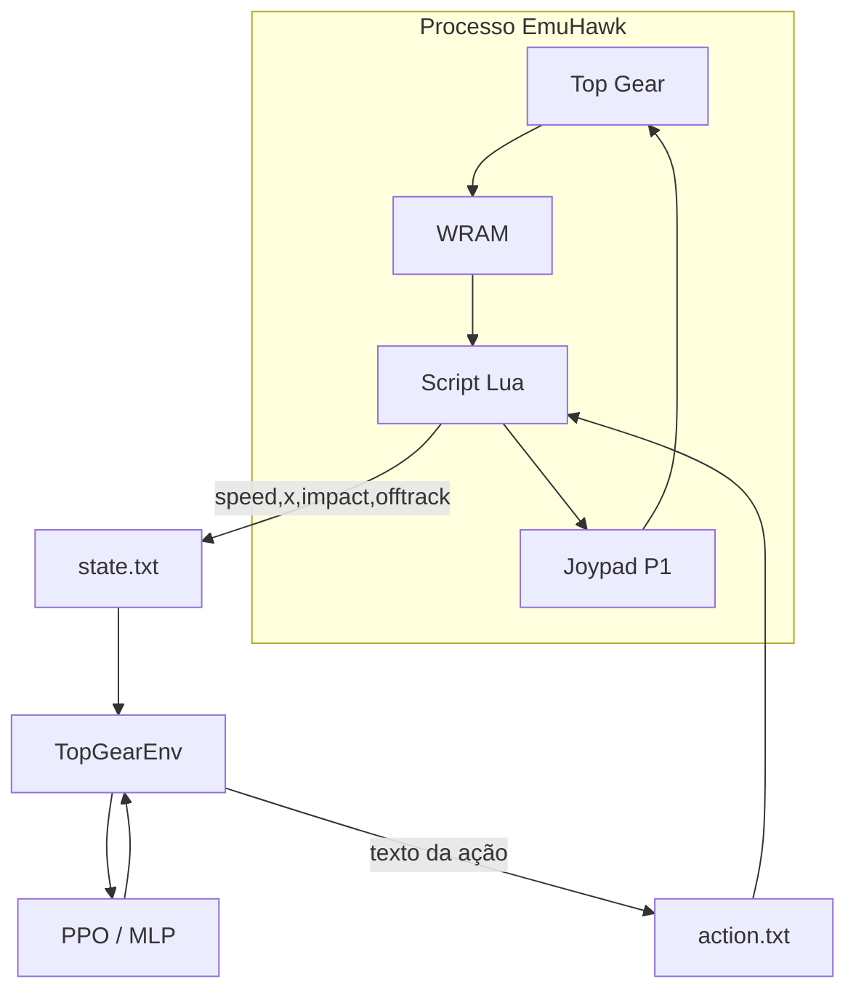

# Diagnóstico técnico completo — TCC TopGear-RL

> **Nota de versão:** este documento diagnostica os arquivos recebidos antes da
> implementação. Para saber o que já foi corrigido na cópia v2, consulte
> `CORRECOES_IMPLEMENTADAS.md`. As pendências que exigem BizHawk real continuam
> explicitamente abertas.

**Data da auditoria:** 2 de setembro de 2026  
**Escopo:** projeto Python/Lua, ROM, BizHawk, ambientes Python, modelos, logs, protocolo e memória do jogo.  
**Método:** somente leitura e testes seguros. **Nenhum arquivo do projeto foi alterado.**

## Conclusão executiva

O projeto possui um baseline pequeno e compreensível — BizHawk + Lua + arquivos de texto + ambiente Gymnasium + PPO —, mas o ambiente atual ainda não representa o problema “vencer uma corrida de Top Gear”. Hoje ele representa, aproximadamente, “manter velocidade alta sem sair de uma faixa X fixa e sem sofrer quedas bruscas de velocidade”.

As conclusões decisivas são:

1. **O agente atual não recebe nenhuma informação sobre adversários.** O estado enviado ao Python tem somente quatro números: velocidade, uma suposta coordenada X, impacto inferido e offtrack inferido. Não há carro, distância, posição relativa, faixa ocupada, velocidade relativa ou máscara de entidades.
2. **A ROM fornecida contém informação suficiente para construir percepção de adversários sem visão computacional.** A análise estática da ROM exata encontrou uma tabela de **20 registros de competidores** na WRAM, incluindo 2 jogadores e 18 adversários, com stride de `0x12` bytes. Há fortes evidências de campos de ID, posição lateral, progresso, volta e movimento/velocidade do adversário.
3. **`0x1E5A` é, de fato, um endereço forte de velocidade/movimento do jogador.** Ele aparece repetidamente nas rotinas de física da ROM e é comparado com `0x1900` (6400). O diagnóstico anterior de “endereço possivelmente errado” era prudente sem a ROM; com a ROM agora disponível, há suporte estático forte. Ainda falta confirmar ao vivo unidade, sinal e comportamento nos estados extremos.
4. **`0x09C2` não tem suporte estático como posição lateral.** O par de bytes aparece apenas uma vez na ROM e não como operando absoluto de leitura/escrita. Em contraste, `0x1E8A` é usado repetidamente como posição lateral do jogador 1 e participa das rotinas de colisão. O `x=184` residual do projeto e os limites `345..435` são, portanto, altamente suspeitos.
5. **O agente não consegue frear nem usar turbo.** O espaço `Discrete(4)` oferece apenas nada, acelerar, esquerda+acelerar e direita+acelerar. Freio e turbo são impossíveis por construção; também não é possível esterçar sem acelerar.
6. **O reward não contém o objetivo final.** Não usa progresso, volta, rank, ultrapassagem, chegada ou colocação final. Primeiro e último lugar podem gerar exatamente o mesmo reward.
7. **A ponte não é causal.** O Lua publica estado antes de ler/aplicar a ação; o Python dorme 20 ms e lê qualquer estado bem formatado. Não há sequência, frame, confirmação nem garantia de que `s_{t+1}` resulte de `a_t`.
8. **O reset pode ser repetido várias vezes.** `RESET` permanece no arquivo, o Lua o relê e pode recarregar o slot 1 em loop. O retorno de `savestate.loadslot(1)` não é verificado e não há confirmação pós-reset.
9. **O modelo da cópia histórica principal não chegou ao primeiro update PPO.** Ele tem 1.814 passos com `_n_updates=0`; é essencialmente uma inicialização. O modelo da ramificação corrigida tem 2.659 passos e apenas uma coleta de rollout otimizada por 10 épocas, sobre o estado repetitivo `0,184,0,1`.
10. **Os logs positivos antigos não provam habilidade de corrida.** Eles mostram que o PPO aprendeu o reward disponível. Como não foram registrados rank, voltas, chegada, colisões reais ou vitórias, não é possível concluir que o agente aprendeu a vencer.

O motivo técnico principal de o carro bater nos adversários à frente é direto: **antes do contato, pista livre e carro bloqueando a mesma faixa podem produzir a mesma observação**. A rede é obrigada a tomar a mesma decisão nos dois casos. Isso não se resolve com mais timesteps, rede maior ou troca de PPO; resolve-se expondo telemetria de adversários, acrescentando ações necessárias e alinhando o reward à corrida.

---

## Escopo, artefatos e grau de evidência

### Pacotes auditados

| Artefato | SHA-256 | Conteúdo e papel |
|---|---|---|
| `TCC-TopGear-RL.rar` | `12a4ad7fab2f6319f039e189b92a9245a9989a9fdeadf7453613d4d97dec4b6d` | Cópia histórica principal: fontes com caminho `D:\TCC-TopGear-RL`, modelo, runs e venv Python 3.13 |
| `Nova pasta.zip` | `97b736f812506b65f7fdbea3cf5ac6c713fb3c358678cb7a35ffa5a51712375c` | Réplica posterior em outra máquina, com venv Python 3.12 e pequenas diferenças de codificação/caminhos |
| `TCC-TopGear-RL_corrigido(1).zip` | `41aec05b1afb971ed878ce8d8528198c3a806fb919851c7752427b58272ea825` | Ramificação de correções de infraestrutura: caminhos relativos, diagnóstico de RAM, requirements e runs/modelo adicionais |
| `BizHawk-2.11.1-win-x64.zip` | `dd7cbd5e205b09c5bce6afabc4f8aa525acc0bbeb9753b198a8db3fe6a5e5717` | Distribuição íntegra do BizHawk 2.11.1, sem configuração pessoal nem savestate |
| `Top Gear.zip` | `3650d08358814ab584d6dd77518140a9c24e3f0a3a1b8844b6b42b52b9059e7c` | ROM finalmente fornecida: `Top Gear (USA).sfc` |

Todos os ZIPs passaram no teste CRC e não apresentaram entradas inseguras, criptografadas ou duplicadas. O RAR foi percorrido integralmente sem erro de leitura. A ROM **não** estava no RAR anterior; ela chegou somente em `Top Gear.zip`.

### Identidade da ROM

| Propriedade | Valor |
|---|---|
| Arquivo | `Top Gear (USA).sfc` |
| Tamanho | 524.288 bytes, sem copier header |
| SHA-1 | `f686806c676a4b087a3627babbe3555d3704e3b1` |
| SHA-256 | `ca9889f17f184b3d99a2eaaa82af73e366f03ed00313fdd369e5e023b208e788` |
| MD5 | `e5040a079ff03eb93747424af9be75f4` |
| CRC32 | `d34c49b7` |
| Header | `TOP GEAR`, LoROM, região USA, versão 0 |
| Reset vector | `0x8000` |
| Banco do BizHawk | SHA-1 reconhecido como **Top Gear (USA), Good** |

O CRC32 coincide também com a página comunitária do jogo no [GameHacking.org](https://gamehacking.org/game/45196). Essa fonte foi usada apenas como corroboração; as conclusões principais de memória vêm da própria ROM enviada.

### Identidade do emulador

O `EmuHawk.exe` fornecido é BizHawk `2.11.1.0`, product version `2.11.1+bdddf4a58aa1a022afb11dc73294a81a5aa7bbd5`, SHA-256 `f8cdb93551a544f680bf3876d9d8d72643859e7a44a23b04e1a25b92e48f80cd`.

O pacote contém três cores SNES (`bsnes`, `libsnes` e `snes9x`), mas não contém `config.ini`, configuração de sync, savestate do slot 1 ou indicação do core usado nos treinos. Portanto, a distribuição é conhecida, mas a **configuração efetiva da execução histórica não é reproduzível** apenas pelos arquivos enviados.

### Rótulos de evidência

- **[CÓDIGO]**: observado diretamente nos fontes Python/Lua.
- **[ARTEFATO]**: confirmado em ZIP/RAR, modelo, log, metadado ou execução isolada.
- **[ROM-ESTÁTICA]**: confirmado por estrutura, referências e fluxo de código na ROM exata, sem afirmar ainda unidade/semântica dinâmica que precise de jogo ao vivo.
- **[TESTE AO VIVO PENDENTE]**: precisa de BizHawk executando a ROM e o savestate reais.
- **[INFERÊNCIA]**: consequência técnica sustentada pelas evidências anteriores.

Testes realizados incluem inventário e hash, compilação sintática dos seis Python de cada ramificação, inspeção segura de modelos SB3 e tensores, reconstrução do forward da política, agregação de `monitor.csv` e TensorBoard, simulação isolada da lógica do ambiente, leitura da API Lua incluída no BizHawk e análise estática 65C816/LoROM da ROM. Não foi possível executar o EmuHawk Windows neste ambiente nem reproduzir o slot 1, que não foi enviado; todas as conclusões dinâmicas são marcadas como pendentes.

---

# A) Arquitetura atual do projeto

## 1. Qual cópia representa o quê

As três árvores do projeto não são idênticas:

- **RAR / `D:\TCC-TopGear-RL`**: melhor evidência da cópia histórica principal. Os caminhos do fonte e os metadados do TensorBoard no modelo apontam para essa árvore. Tem logs até 25/08 e modelo de 1.814 passos.
- **`Nova pasta.zip`**: cópia da mesma base em `C:\Users\luanb\OneDrive\Área...`, com BOM/mojibake em alguns textos e outro venv. O modelo e os logs principais são byte a byte iguais aos do RAR.
- **ZIP corrigido**: ramificação posterior de infraestrutura. Remove caminhos fixos, troca o falso teste TCP por monitor de arquivos, adiciona `requirements.txt`, README e `diagnostico_memoria.lua`. Também contém runs de setembro e um **modelo diferente**, por isso não deve ser confundido com o modelo histórico do RAR.

Recomendação de proveniência: preservar RAR/modelo/logs como histórico imutável e, quando a implementação começar, escolher explicitamente uma única árvore de trabalho. A ramificação corrigida é a melhor base de fonte por já ter caminhos relativos, mas suas mudanças precisam ser portadas/revisadas conscientemente; não se deve misturar modelos e runs entre árvores como se fossem o mesmo experimento.

## 2. Inventário funcional

| Camada | Arquivo/componente | Responsabilidade atual | Situação |
|---|---|---|---|
| Jogo | ROM `Top Gear (USA).sfc` | Simular corrida, jogadores e 18 IAs | ROM íntegra e identificada |
| Emulação | BizHawk/EmuHawk | Executar SNES, expor WRAM, Lua, joypad e savestate | Binário íntegro; core/config/slot históricos ausentes |
| Ponte Lua | `lua/Top Gear (USA).lua` | Ler dois endereços, inferir duas flags, escrever estado, ler ação e avançar frame | Funciona como protótipo, mas não é causal nem observa corrida/adversários |
| Diagnóstico | `lua/diagnostico_memoria.lua` | Comparar RAM sob acelerar/frear/esquerda/direita | Só existe no ZIP corrigido; útil, porém limitado a `0x0000..0x1FFF` e a speed/X |
| Transporte | `state.txt`, `action.txt` | Mailboxes compartilhadas por arquivo | Sem versão, atomicidade, sequence ID, frame ou heartbeat |
| Ambiente RL | `python/env_topgear.py` | API Gymnasium, normalização, reward e terminação | Contrato básico correto; observação/ação/reward insuficientes |
| Treino | `python/train_hermes_ppo.py` | Criar Monitor/PPO, treinar e salvar | Sem preflight, avaliação, checkpoints, retomada ou best model |
| Inferência | `python/play_hermes.py` | Carregar modelo e agir deterministicamente | Simples; sem checagem de schema/liveness |
| Teste | `python/smoke_test_env.py` | Executar ações aleatórias | Não possui asserts nem valida causalidade |
| Leitor | `python/read_state.py` | Imprimir quatro campos | Frágil a arquivo parcial/ausente |
| “Conexão” | `python/test_connection.py` | No original, servidor TCP abandonado; no corrigido, observador de arquivo | O original nunca conversa com o Lua atual |
| Modelo | `models/hermes-rl-ppo.zip` | Política PPO | Há duas versões distintas; nenhuma representa agente competitivo |
| Logs | `runs/**` | Monitor e TensorBoard | Mostram reward/otimização, não desempenho de corrida |
| Dependências | venvs copiados / `requirements.txt` corrigido | Ambiente Python | Três pilhas incompatíveis; venvs Windows não são portáveis |

## 3. Topologia atual



É uma arquitetura de dois processos sem relógio compartilhado: o loop Lua é governado por frames do emulador; o Python é governado por `sleep()` de tempo de parede.

## 4. Dependências e ambiente

### Venv do RAR

- Python 3.13.2;
- Stable-Baselines3 2.7.1;
- Gymnasium 1.2.3;
- NumPy 2.4.2;
- PyTorch 2.10 CPU;
- TensorBoard 2.20;
- caminhos de ativação absolutos da antiga máquina.

### Venv de `Nova pasta`

- Python 3.12.10;
- Stable-Baselines3 2.9.0;
- Gymnasium 1.3.0;
- NumPy 2.5.2;
- PyTorch 2.13.0;
- sem pacote TensorBoard/protobuf encontrado.

Como o treino configura `tensorboard_log`, a cópia Nova provavelmente falha ao inicializar o logger TensorBoard usando exatamente esse venv. Além disso, os scripts de ativação referem-se ao caminho original da máquina e não tornam o venv copiável entre PCs.

### Ramificação corrigida/modelo de setembro

O metadado do modelo registra Python 3.11.9, SB3 2.9.0, Gymnasium 1.3.0, NumPy 2.0.2 e PyTorch 2.8 CPU. Isso confirma **três ambientes diferentes**. O `requirements.txt` sem versões ajuda a instalar, mas não reproduz nenhum deles.

## 5. Scripts auxiliares e arquivos de runtime

- `smoke_test_env.py` executa ações aleatórias, imprime dados e para após dois episódios. É útil como ensaio manual, mas não contém asserts, não mede frames e usa `reset_sleep=0.6`, diferente do default `1.2` do ambiente.
- `read_state.py` faz polling infinito a cada 30 ms. No original usa caminho absoluto e não tolera arquivo ausente, vazio parcial ou número incorreto de campos.
- `play_hermes.py` usa `deterministic=True`, imprime a cada 50 passos e reseta infinitamente. Não verifica se o modelo tem o mesmo schema/protocolo do ambiente nem se o Lua está vivo.
- `action.tmp` contém `NADA`, mas nenhum código o lê ou grava. Não fornece atomicidade.
- `state.txt` e `action.txt` são estado transitório, porém foram empacotados como se fossem fonte. Os valores residuais diferem entre cópias e podem controlar o jogo ao iniciar o Lua.
- Os venvs e `__pycache__` ocupam quase todo o volume dos pacotes e não são portáveis; não são dependências reproduzíveis.

---

# B) Fluxo completo de dados e ações

## 1. Estado: BizHawk/Top Gear até a rede

1. O BizHawk executa a ROM e expõe os domínios de memória ao Lua.
2. O Lua tenta selecionar `WRAM`, mas ignora o retorno de `memory.usememorydomain("WRAM")`.
3. A cada iteração, lê `u16_le(0x1E5A)` como `speed` e `u16_le(0x09C2)` como `x_pos`.
4. Calcula `impact` quando `prev_speed - speed >= 1000`, mantendo a flag por 12 iterações Lua.
5. Calcula `offtrack=1` se `x_pos <= 345` ou `x_pos >= 435`.
6. Trunca e reescreve `state.txt` com `speed,x,impact,offtrack`.
7. O Python lê quatro inteiros, tentando novamente em caso de vazio/formato incorreto.
8. Limita a velocidade a `[0,6500]`, binariza flags e recalcula offtrack com outro limiar.
9. Gera a observação `float32`: `obs = [speed/6500, (x-390)/50, impact, offtrack]`.
10. O `MlpPolicy` do PPO converte os quatro floats em logits para quatro ações e, durante treino, amostra a distribuição; durante `play`, usa o maior logit.

## 2. Ação: rede até o BizHawk

1. O PPO retorna inteiro `0..3`.
2. O ambiente converte para `NADA`, `ACELERAR`, `ESQUERDA` ou `DIREITA` e reescreve `action.txt`.
3. O Lua lê o texto e aplica ao jogador 1:

| Ação RL | Texto | Botões SNES lógicos |
|---:|---|---|
| 0 | `NADA` | nenhum |
| 1 | `ACELERAR` | `X` |
| 2 | `ESQUERDA` | `Left + X` |
| 3 | `DIREITA` | `Right + X` |
| reset fora do action space | `RESET` | carrega slot 1, neutraliza e avança 10 frames |

4. O Lua chama `emu.frameadvance()`. Pela API do BizHawk, `joypad.set` vale para o frame corrente; por isso o texto persistente é reaplicado a cada frame. Consulte a [API Lua do BizHawk](https://tasvideos.org/Bizhawk/LuaFunctions).

Os controles são nomes lógicos SNES, independentes das teclas físicas. O pacote BizHawk associa, por padrão, `P1 X` à tecla S/controle Y, mas a ROM oferece layouts de controle selecionáveis. O [manual de Top Gear](https://archive.org/details/top-gear-usa) confirma múltiplos layouts; portanto, é obrigatório validar no savestate se `X` acelera e qual botão freia/turbo.

## 3. Ordem temporal real

O Lua faz:

```text
ler memória
→ publicar estado atual
→ ler ação disponível
→ aplicar ação
→ avançar um frame
```

O Python faz:

```text
publicar ação
→ dormir 20 ms
→ aceitar o próximo conteúdo bem formatado de state.txt
```

Não há garantia de que o estado aceito foi produzido após a ação. Dependendo do agendamento, ele pode representar zero, um ou vários frames de aplicação. Se o Lua parar, o Python continua aceitando indefinidamente um estado antigo.

## 4. Reset atual

No Python: `escrever RESET → dormir 1,2 s → ler qualquer estado disponível`.

No Lua original, cada leitura de `RESET`:

1. escreve o marcador falso `9999,390,0,0` em `state.txt`;
2. chama `savestate.loadslot(1)` sem verificar sucesso;
3. neutraliza joypad;
4. avança 10 frames.

O ZIP corrigido remove o marcador falso, mas não resolve a repetição. Como o Python deixa `RESET` no arquivo durante 1,2 s, o Lua pode executar o bloco várias vezes. `prev_speed` e `impact_cooldown` são estado do processo Lua e não voltam com o savestate.

## 5. Pontos exatos no fonte histórico do RAR

| Fluxo | Arquivo e linhas |
|---|---|
| Caminhos absolutos e endereços | `lua/Top Gear (USA).lua:1-8` |
| Leitura/fallback de memória | `lua/Top Gear (USA).lua:11-20` |
| Heurística de impacto/offtrack | `lua/Top Gear (USA).lua:23-50` |
| Publicação do estado | `lua/Top Gear (USA).lua:52-57` |
| Leitura da ação | `lua/Top Gear (USA).lua:59-66` |
| Marcador/reset/load/10 frames | `lua/Top Gear (USA).lua:68-89` |
| Mapa de joypad | `lua/Top Gear (USA).lua:90-103` |
| Espaços Gym | `python/env_topgear.py:45-52` |
| Parsing/saneamento/normalização | `python/env_topgear.py:113-156` |
| Reset Python | `python/env_topgear.py:161-181` |
| Step/reward/terminações | `python/env_topgear.py:186-234` |
| PPO/hiperparâmetros | `python/train_hermes_ppo.py:20-32` |
| Sobrescrita em `finally` | `python/train_hermes_ppo.py:34-44` |
| Servidor TCP abandonado | `python/test_connection.py:1-18` |

---

# C) Como o agente atualmente observa o jogo

## 1. Vetor efetivo

O espaço declarado é `Box(shape=(4,), dtype=float32)`:

```text
low  = [0, -5, 0, 0]
high = [2,  5, 1, 1]
```

| Índice | Feature atual | Fonte | Interpretação real |
|---:|---|---|---|
| 0 | `vel_norm` | `u16_le(0x1E5A) / 6500` após clip | Endereço fortemente suportado como movimento/velocidade P1; leitura deveria respeitar sinal |
| 1 | `x_norm` | `(u16_le(0x09C2)-390)/50` | Sem suporte estático como X; provavelmente variável errada |
| 2 | `impact` | queda de velocidade ≥1000, cooldown 12 | Heurística posterior; não é sensor de carro nem flag de colisão |
| 3 | `offtrack` | limiar fixo sobre o X suspeito | Não representa geometria real da pista e duplica regra Lua/Python |

### Velocidade `0x1E5A`

**[ROM-ESTÁTICA, confiança alta]** O endereço aparece 77 vezes como operando little-endian em código plausível: dezenas de `LDA`, `STA`, `ADC`, `SBC` e comparações. As rotinas de física o relacionam a marcha em `0x1E72` e comparam com `0x1900` (6400), coerente com o clip 6500 usado pelo projeto. O equivalente do jogador 2 é `0x1E5C`.

Entretanto, há testes de sinal (`BMI`) sobre esse valor. O Lua usa leitura **unsigned**. Se o jogo produzir temporariamente `0xFFFF` para movimento negativo, o ambiente converte 65535 para 6500 e concede reward máximo. A correção futura deve ler/decodificar `s16` ou, no mínimo, testar explicitamente os estados negativos no BizHawk.

### Posição lateral `0x09C2`

**[ROM-ESTÁTICA, confiança muito baixa]** `C2 09` aparece uma única vez nos 512 KiB da ROM e naquele local faz parte de uma sequência de dados/instrução que não constitui referência absoluta a `$09C2`. Não foram encontradas rotinas lendo/escrevendo diretamente esse endereço.

**[ROM-ESTÁTICA, candidato forte]** `0x1E8A` é a posição lateral assinada do jogador 1; `0x1E8C`, a do jogador 2. Ela é copiada entre globais e registros dos corredores, comparada nas rotinas de sobreposição e limitada com aritmética assinada. Esse endereço deve substituir `0x09C2` **somente depois do teste ao vivo** de esquerda/direita, centro, bordas e curvas.

### Contratos inconsistentes

- Lua considera fora da pista em `x <= 345` ou `x >= 435`.
- Python adiciona `abs(x-390) > 60`.
- O OR torna o limiar Lua normalmente dominante, mas existem duas definições.
- `vel_norm` nunca excede 1 por causa do clip, embora o Box permita 2.
- X não é clipado: `x=65535` produz `x_norm=1302,9`, fora do Box.

### Estado residual enviado

As três cópias têm `state.txt = 0,184,0,1`. Isso vira `[0,-4.12,0,1]`. No modelo corrigido, esse mesmo vetor está gravado como `_last_obs`; os 29 episódios de setembro têm exatamente 91 passos e retorno `-91`, compatível com estado zero/offtrack constante e término por `stuck_steps_limit`.

## 2. Informação que não chega à rede

Embora parte dela exista na ROM, o protocolo atual não envia:

- progresso na pista;
- volta;
- posição/rank;
- estado de chegada e classificação final;
- centro, largura ou curvatura real da pista;
- combustível, marcha ou nitro;
- posição/velocidade lateral válida;
- qualquer registro de adversário;
- distância frontal ou lateral;
- velocidade relativa/tempo para colisão;
- faixa livre;
- flag direta de contato;
- histórico temporal/frame stacking.

## 3. Suficiência por comportamento

| Objetivo desejado | Observação/ação atual suficiente? | Motivo |
|---|---|---|
| Acelerar | Parcial | Ação existe e `0x1E5A` é forte; escala/sinal ainda precisam de teste vivo |
| Frear | **Não** | Ação ausente |
| Fazer curvas | **Não de forma robusta** | Pode esterçar, mas não percebe curva futura nem centro real |
| Permanecer na pista | **Não validado** | Depende do X fraco e de limites fixos |
| Ver adversários | **Não** | Zero campos de adversário chegam ao Python |
| Mudar de faixa | Parcial mecanicamente | Esterça sempre acelerando; não sabe ocupação/faixas |
| Ultrapassar | **Não intencionalmente** | Sem alvo, distância, rank ou evento de ultrapassagem |
| Usar turbo | **Não** | Sem ação e sem estado de nitro |
| Reduzir antes de curva/carro | **Não** | Sem lookahead e sem freio |
| Maximizar posição | **Não** | Rank ausente da observação e do reward |
| Completar corrida | **Não é objetivo do ambiente** | Sem volta/finish/progresso |
| Chegar em primeiro | **Não representado** | Primeiro e último podem ser observacionalmente idênticos |

Isso cria **aliasing perceptual**: reta livre, curva próxima e adversário diretamente à frente podem gerar o mesmo vetor. Nenhuma MLP, por maior que seja, recupera informação que não foi observada.

---

# D) Como funciona o reward

Depois do warmup de 30 passos Python:

```text
r_t = clip(speed, 0, 6500) / 6500
      - 2 × impact
      - 1 × offtrack
```

Faixa nominal por passo: `[-3,+1]`. Não há termo terminal.

## 1. O que ele incentiva

- velocidade instantânea alta;
- evitar o X classificado como fora da pista;
- evitar quedas bruscas de velocidade.

## 2. O que ele não incentiva

- deslocamento longitudinal útil;
- completar volta/corrida;
- melhorar rank;
- ultrapassar;
- terminar em primeiro;
- distância de segurança;
- uso eficiente de turbo/combustível;
- frenagem antecipada;
- trajetória limpa em curva.

## 3. Falhas de alinhamento e exploits possíveis

1. **Velocidade não é progresso.** O reward não prova que o carro avança corretamente na corrida.
2. **Sem objetivo terminal.** Uma política em último lugar pode pontuar igual à líder.
3. **Colisão tardia e ambígua.** `impact` só aparece após grande queda de velocidade; choque leve pode não aparecer e frenagem/terreno podem gerar falso positivo.
4. **Custo variável com timing.** O cooldown usa iterações Lua, enquanto o PPO amostra em passos de tempo de parede. O mesmo choque pode ser cobrado por quantidades diferentes de passos.
5. **Leitura unsigned pode fabricar reward máximo.** Um valor negativo de velocidade interpretado como 65535 é clipado para 6500.
6. **Terminar cedo pode ser vantajoso.** Em um regime de `-1` por passo, ficar parado encerra o episódio por travamento por volta do passo 91 e evita até 3.000 passos negativos. Não existe penalidade por falha.
7. **Offtrack pode punir manobra legítima.** A faixa fixa não acompanha curvas/largura/variação da pista.
8. **Warmup é medido na unidade errada.** Trinta passos Python não correspondem a número fixo de frames e podem ocultar colisões reais.
9. **Reward denso domina eventual bônus tardio.** Com `gamma=0.99`, um bônus após 1.500 passos tem peso aproximado de `2,8×10⁻⁷` no início. Somar apenas “+100 ao vencer” sem corrigir horizonte e shaping não resolve crédito temporal.

## 4. Terminação e truncamento atuais

| Condição | Parâmetros | Resultado | Problema |
|---|---|---|---|
| Lentidão | `speed < 1200` por 120 steps | `terminated=True` | não significa derrota/fim de corrida e depende do timing assíncrono |
| Travamento | variação de speed ≤2 e X ≤1 por 90 comparações | `terminated=True` | com estado constante encerra no step 91; confunde ponte morta com episódio válido |
| Limite técnico | 3.000 steps | `truncated=True` | não corresponde a número fixo de frames nem ao fim da corrida |

Não há término por vitória, chegada, combustível, abandono ou tela fora da corrida. Como os testes são independentes, um step pode retornar `terminated=True` e `truncated=True` simultaneamente. Também não há recompensa/penalidade terminal diferenciando sucesso, falha e timeout.

## 5. Forma recomendada, sem fixar pesos prematuramente

```text
r_t = w_p × delta_progresso
    + w_r × (potencial_rank_t+1 - potencial_rank_t)
    + bônus_ultrapassagem_confirmada
    - penalidade_evento_colisão
    - penalidade_tempo_fora
    - penalidade_sem_progresso
    + bônus_chegada
    + bônus_colocação_final
    + bônus_extra_primeiro
```

Princípios:

- usar deltas para não pagar indefinidamente por “estar em primeiro”;
- tratar wrap de volta e reset;
- deduplicar colisão por borda do bit/evento;
- fazer primeiro lugar superar qualquer vantagem acumulada por terminar pior;
- registrar cada componente separadamente;
- calibrar pesos após medir unidades e frames por step;
- usar velocidade como feature/regularizador, não como objetivo principal.

---

# E) Como funciona o treinamento

## 1. Algoritmo e hiperparâmetros

| Item | Valor |
|---|---:|
| Algoritmo | PPO, Stable-Baselines3 |
| Policy | `MlpPolicy` |
| Ambientes | 1 |
| Ação | `Discrete(4)` |
| Observação | 4 floats |
| `n_steps` | 2048 |
| `batch_size` | 64 |
| `gamma` | 0.99 |
| `learning_rate` | 3e-4 constante |
| `n_epochs` | 10, default |
| `gae_lambda` | 0.95, default |
| `clip_range` | 0.2, default |
| `ent_coef` | 0.0, default |
| `vf_coef` | 0.5, default |
| `max_grad_norm` | 0.5, default |
| Normalização de vantagem | sim |
| Normalização de obs/reward | não; só fórmulas manuais |
| Memória/frame stack | nenhum |
| Seed | `None` |
| `total_timesteps` no fonte | 100.000 |

## 2. Rede neural

Os pesos dos dois modelos confirmam a arquitetura default:

```text
observação 4
├─ ator:   Linear 4→64 → Tanh → Linear 64→64 → Tanh → Linear 64→4
└─ crítico: Linear 4→64 → Tanh → Linear 64→64 → Tanh → Linear 64→1
```

São ramos separados, 9.285 parâmetros treináveis. A arquitetura é adequada como baseline para um vetor pequeno e informativo. Não há justificativa técnica para trocar algoritmo/rede antes de corrigir ambiente, sincronização, observação e objetivo.

## 3. Dois modelos diferentes

| Propriedade | Modelo RAR/Nova | Modelo ZIP corrigido |
|---|---:|---:|
| SHA-256 | `06e6f8bdcaab527e2a4e758dd7413bb4b4720d7a1ac9f6727eddf333802f1b8f` | `36af0893b3bb4378256095b4f063cae1244d2f5bc4631fcacbf246b6dcb35311` |
| SB3 | 2.7.1 | 2.9.0 |
| `num_timesteps` | 1.814 | 2.659 |
| `_n_updates` | **0** | 10 |
| Interpretação | rollout de 2048 não concluído; nenhuma otimização PPO | uma coleta de 2048 passos otimizada por 10 épocas |
| Última observação | `[0.2269,-1.72,0,1]` | `[0,-4.12,0,1]` |

No modelo histórico, as probabilidades permanecem praticamente uniformes e `deterministic=True` tende a escolher `NADA` em sua última observação. No corrigido, a distribuição na última observação é aproximadamente 23% nada, 28% acelerar, 22% esquerda e 27% direita: também está próxima do acaso.

## 4. Logs

### Runs históricas principais

| Run | Episódios completos | Passos observados | Retorno médio | Nota |
|---|---:|---:|---:|---|
| `20260302_194435` | 2 | 1.197 | -330,24 | sem rollout completo |
| `20260302_203926` | 134 | 200.648 | 869,03 | TensorBoard até 200.704; retorno melhora muito |
| `20260822_154224` | 0 | 0 | — | vazia |
| `20260822_154835` | 0 | 0 | — | só cabeçalho/evento |
| `20260822_155052` | 10 | 14.323 | -720,91 | baixo retorno |
| `20260822_161328` | 30 | 46.305 | 632,09 | melhora do primeiro para o último bloco |
| `20260825_172916` | 1 | 1.432 | -776,65 | origem do modelo RAR parcial |

O treino de março alcançou 200.704 passos, embora o fonte entregue use 100.000. Logo, o código/configuração usados nessa execução não foram congelados junto à run. A entropia caiu e a variância explicada chegou a cerca de 0,93, mostrando que PPO conseguiu ajustar-se ao reward existente; isso não demonstra voltas, colocação ou vitória.

### Runs da ramificação corrigida

Em `20260901_173614`, há 29 episódios, todos com retorno exatamente `-91` e comprimento 91. Isso é assinatura de telemetria constante/offtrack e término por travamento, não corrida real.

## 5. Infraestrutura de treino ausente

- nenhum preflight de ROM/core/Lua/savestate;
- nenhum `check_env` automatizado;
- nenhum checkpoint periódico;
- nenhum `EvalCallback` ou best model;
- nenhuma retomada explícita;
- nenhuma seed/cenário fixo;
- nenhuma política aleatória/scripted de comparação;
- nenhuma métrica de progresso, rank, volta, finish, vitória ou colisão real;
- nenhuma captura do código/config/endereço usado por run;
- `finally` sempre sobrescreve `models/hermes-rl-ppo.zip`, inclusive após erro ou interrupção antes do primeiro update.

Esse último ponto explica como um modelo potencialmente melhor pode ser substituído por um artefato quase aleatório.

---

# F) Comunicação Python ↔ Lua ↔ BizHawk

## 1. Protocolo atual

| Direção | Meio | Payload | Validação |
|---|---|---|---|
| Lua → Python | `state.txt` | quatro inteiros CSV | somente formato |
| Python → Lua | `action.txt` | uma string | desconhecido vira `NADA` |

Não é TCP. O `test_connection.py` do RAR/Nova abre servidor `127.0.0.1:5000` e bloqueia em `accept()`, mas nenhum Lua cria cliente TCP. É um protótipo morto e não testa a integração entregue. O ZIP corrigido troca esse arquivo por um observador de conteúdo/mtime, que testa atividade grosseira, mas ainda não prova ação→ack.

## 2. Problemas de caminho

- Lua/Python originais usam `D:\TCC-TopGear-RL` absoluto.
- Nova foi copiada para outra pasta; o default do ambiente contém mojibake no trecho `Área`, embora `train`/`play` passem um caminho correto explicitamente.
- A ramificação corrigida deriva a raiz e é a solução que deve ser preservada.

## 3. Falhas de sincronização e robustez

1. **Sem sequência/ack/frame.** Não se sabe qual ação produziu o estado.
2. **Escrita não atômica.** Abrir com `w` trunca antes de gravar; o leitor pode ver vazio/parcial. `action.tmp` existe, mas nunca é usado.
3. **Estado velho é válido.** Quatro inteiros antigos passam no parser indefinidamente.
4. **Falhas Lua são silenciosas.** Arquivo, domínio, leitura e loadstate podem falhar sem parar o treino.
5. **Fallback para zero mascara defeito.** Falha de memória vira `speed=0` em vez de erro fatal.
6. **Reset persistente.** O mesmo comando pode ser executado repetidamente.
7. **Estado Lua não reseta.** `prev_speed` e cooldown sobrevivem ao loadstate.
8. **Ação residual.** Os pacotes foram entregues com `action.txt` variando entre `ESQUERDA`, `RESET` e `DIREITA`; iniciar Lua antes do Python pode aplicar essa ação.
9. **`close()` não neutraliza.** Último comando pode permanecer ativo depois de encerrar o Python.
10. **Unidade temporal variável.** `sleep(0.02)` não fixa número de frames por step; desempenho do host/core altera a dinâmica vista pelo PPO.

O BizHawk oferece `memory.getmemorydomainlist()`, tamanho/domínio atual, retorno booleano de `usememorydomain`, `emu.framecount()`, retorno de `savestate.loadslot` e `event.onloadstate`. O projeto não usa essas garantias. Há ainda uma opção do core Snes9x relativa a atualização de domínios somente no VBlank; sem `config.ini` não sabemos se esteve ativa, reforçando a necessidade de registrar core/config/frame.

## 4. Avaliação do `diagnostico_memoria.lua`

O script da ramificação corrigida é uma boa base experimental porque carrega o mesmo slot, aplica sequências controladas e classifica diferenças de bytes/words. Ele não integra o projeto histórico original e não há `diagnostico_ram.txt` produzido nos pacotes.

Limitações concretas:

- assume sem verificar que `X` acelera e `Y` freia no layout atual;
- ignora o retorno de `usememorydomain` e `loadslot`;
- varre somente `0x0000..0x1FFF`; a tabela de corredores está dentro dessa faixa, mas os candidatos de geometria `0x4000/0x7002` ficam fora;
- procura variações genéricas de speed/X, não estrutura repetida, ID, progresso, volta, rank ou carros;
- o teste de velocidade pode ser contaminado por curva, terreno ou colisão com IA durante os frames;
- no teste lateral, o snapshot central ocorre 35 frames antes dos snapshots esquerda/direita. Esquerda e direita são comparáveis entre si porque partem do mesmo savestate, mas cada diferença em relação ao “centro” mistura passagem de tempo com direção;
- não registra `emu.framecount`, séries por frame, overlay ou identidade da ROM/core.

A correção metodológica é acrescentar um terceiro ramo **neutro por exatamente os mesmos 35 frames** e comparar `left-neutral` e `right-neutral`, além de gravar séries e repetir em cenários sem tráfego.

## 5. Protocolo mínimo recomendado, preservando a ponte por arquivos

Não é necessário migrar para socket neste momento. Um protocolo causal pode continuar usando arquivos:

```text
action.v2:
version,episode_id,action_seq,action_id,repeat_frames

state.v2:
version,episode_id,ack_action_seq,emu_frame,reset_ok,telemetria...
```

Contrato:

1. Python publica arquivo temporário e renomeia atomicamente.
2. Lua processa cada `action_seq` uma única vez.
3. Lua aplica a ação por `repeat_frames` fixos.
4. Só depois lê a memória e publica estado com o mesmo `ack_action_seq`.
5. Python espera ack novo com timeout; heartbeat/frame precisam avançar.
6. Reset é comando one-shot, verifica `loadslot`, limpa estado Lua e confirma via `event.onloadstate`/telemetria pós-reset.
7. Inicialização e `close()` publicam ação neutra.

Isso restaura a semântica `(s_t,a_t,r_t,s_{t+1})` sem reescrita desnecessária da arquitetura.

---

# G) Problemas e bugs encontrados, classificados por criticidade

## Críticos — invalidam o objetivo ou as transições

| ID | Problema | Impacto |
|---|---|---|
| C1 | Nenhuma informação de adversários chega ao agente | evitar/ultrapassar conscientemente é impossível |
| C2 | Reward não usa progresso, rank, finish nem primeiro lugar | objetivo otimizado não é vencer |
| C3 | Sem freio, turbo e esterço sem aceleração | comportamentos exigidos são inalcançáveis |
| C4 | Estado não é causalmente associado à ação | PPO aprende com transições temporalmente incorretas |
| C5 | `0x09C2`/limites X não têm suporte; `0x1E8A` é o candidato real | offtrack e posição lateral provavelmente errados |
| C6 | Reset persistente, não confirmado e potencialmente repetido | início de episódio não determinístico |
| C7 | Modelo canônico é sobrescrito mesmo sem update | perda de resultados e falsa impressão de agente treinado |

## Altos — podem produzir política errada ou treino silenciosamente inválido

| ID | Problema | Impacto |
|---|---|---|
| A1 | `0x1E5A` lido unsigned apesar de uso assinado na ROM | valor negativo pode virar velocidade/reward máximos |
| A2 | `impact` é queda de velocidade, não colisão direta | falsos positivos/negativos e detecção posterior |
| A3 | Estado antigo/parcial pode ser aceito; erro de memória vira zero | ponte morta parece episódio válido |
| A4 | Sem progresso, curva, volta ou rank na observação | forte aliasing/partial observability |
| A5 | Termina por lentidão/travamento sem penalidade de falha | desistir cedo pode maximizar retorno em regime negativo |
| A6 | Core, configuração e savestate usados não estão registrados | experimento não reproduzível |
| A7 | Original tem caminhos absolutos; Nova tem default mojibake | execução depende da máquina/pasta |
| A8 | `test_connection.py` original espera TCP inexistente | diagnóstico bloqueia sem testar nada real |
| A9 | Ação residual e ausência de neutralização no fechamento | controle não determinístico/perigoso |

## Médios — prejudicam qualidade, diagnóstico ou ciência

| ID | Problema | Impacto |
|---|---|---|
| M1 | Duas regras de offtrack diferentes | semântica inconsistente |
| M2 | Box não corresponde às features possíveis | observações fora do espaço/checker inconsistente |
| M3 | Diagnóstico cobre só 8 KiB e não busca estruturas | perde candidatos de geometria em `0x4000/0x7002` e não entende entidades |
| M4 | Sem checkpoints, avaliação, seed e configuração por run | não há comparação confiável nem recuperação |
| M5 | Logs só guardam retorno/comprimento | impossível explicar progresso/colisão/vitória |
| M6 | `requirements.txt` sem versões e venvs incompatíveis | resultados não reprodutíveis |
| M7 | Run de 200k não corresponde ao fonte de 100k | código histórico ausente |
| M8 | Ação inválida cai silenciosamente em `NADA` | bugs de schema são ocultados |
| M9 | Contadores de impacto em frames e warmup em steps | penalidade variável |

## Baixos — manutenção

- `action.tmp` abandonado;
- `__pycache__` e venvs completos empacotados;
- nenhum `.gitignore`/manifesto de runtime observado;
- caminho antigo de TensorBoard persiste no metadado do modelo;
- `read_state.py` não trata concorrência;
- sintaxe `str | None` exige Python 3.10+, não documentado.

---

# H) O que está bem implementado e deve ser preservado

1. **Separação simples de responsabilidades:** emulador/Lua, ambiente Gym e treino estão separados.
2. **API Gymnasium atual:** `reset()` e `step()` usam as assinaturas modernas com `terminated`/`truncated`.
3. **PPO como baseline:** é apropriado para ação discreta e vetor pequeno; não há evidência de que o algoritmo seja o gargalo atual.
4. **MLP compacta:** suficiente para a primeira versão de telemetria estruturada.
5. **Ponte por arquivos:** é depurável e aceitável em TCC; deve ganhar protocolo, não ser substituída apenas por preferência arquitetural.
6. **Monitor/TensorBoard:** já estabelecem uma base de instrumentação.
7. **Savestate para cenários controlados:** excelente para reset determinístico e descoberta de memória, quando processado corretamente.
8. **Diagnóstico diferencial da ramificação corrigida:** a ideia de comparar o mesmo savestate sob ações distintas é correta.
9. **Caminhos relativos da ramificação corrigida:** correção necessária que deve ser mantida.
10. **Retentativas contra leitura parcial e `fsync`:** defesas úteis, embora não suficientes.
11. **Inferência determinística separada:** adequada para avaliação.
12. **Endereço `0x1E5A`:** a escolha original de velocidade foi boa e agora tem forte suporte na ROM.
13. **Dados históricos:** runs e modelos, ainda que incompletos, são úteis como evidência e devem ser preservados imutavelmente.

---

# I) Análise específica do problema dos carros adversários

## 1. Capacidade atual

**[CÓDIGO] A capacidade preventiva atual é zero.** Nenhum endereço/feature de adversário é lido pelo Lua principal, transmitido pelo arquivo, declarado no Box ou consumido pela rede. `impact` só relata uma queda brusca depois que algo ocorreu.

O agente pode adquirir um hábito estatístico — por exemplo, dirigir mais à esquerda —, mas não pode condicionar a decisão à presença de um carro específico.

## 2. O que a ROM revelou

### Estrutura global de corredores

**[ROM-ESTÁTICA, confiança alta]** A ROM inicializa 20 registros contíguos: IDs 0 e 1 para os jogadores, IDs 2 a 19 para 18 IAs. Os registros são trocados/ordenados durante a corrida, portanto **índice fixo não identifica um carro**; é necessário usar o ID/campo e os offsets dinâmicos do jogador.

| Elemento | Endereço/forma | Evidência/uso provável |
|---|---|---|
| Comprimento/wrap da pista | `WRAM 0x0200` | módulo usado no avanço/wrap; validar unidade ao vivo |
| Offset do registro P1 | `0x0204` | somado à base para localizar o registro corrente P1 |
| Offset do registro P2 | `0x0206` | equivalente P2 |
| Base da tabela | `0x0212` | 20 registros |
| Stride | `0x12` bytes | registro `i = 0x0212 + i×0x12`, último termina em `0x0379` |

### Campos por registro

| Offset | Tipo candidato | Interpretação | Confiança |
|---:|---|---|---|
| `+0` | byte/flags | 5 bits baixos = ID 0..19; bits altos = flags/config | alta para ID, pendente para flags |
| `+2` | `s16` | posição lateral | alta |
| `+4` | `s16` | velocidade/controle lateral | média-alta; validar |
| `+6` | byte | parte fracionária do movimento longitudinal 24-bit | média-alta |
| `+7` | `u16` | progresso longitudinal dentro da volta | alta |
| `+9` | `u8` | contador de volta do registro | alta |
| `+10` | `u16` | movimento/velocidade longitudinal da IA | média-alta; escala não é necessariamente igual à P1 |
| `+12` | `s16` candidato | delta/aceleração | média |
| `+14` | word/contador | timer de atualização | média |
| `+16` | word/flags | estado/status ainda não decodificado | baixa; precisa de testes |

Há código que compara diferenças laterais entre registros com limiar `0x0800` durante sobreposição/colisão. Isso é forte evidência de que `+2` representa posição lateral; **não** significa ainda que `0x0800` deva ser adotado como “mesma faixa” sem observar as unidades ao vivo.

### Globais do jogador e corrida

| Endereço | Papel identificado na ROM | Confiança e pendência |
|---|---|---|
| `0x1E5A` | velocidade/movimento P1 | alta; testar sinal/escala |
| `0x1E5C` | equivalente P2 | alta |
| `0x1E8A` | posição lateral P1 | alta; testar centro/limites |
| `0x1E8C` | posição lateral P2 | alta |
| `0x1ED7` | progresso P1, representação de 3 bytes relacionada a fração+posição | alta para papel; validar composição/unidade |
| `0x1EDA` | progresso P2 | alta |
| `0x1E76` | volta P1 | alta; começa em valor sentinela antes da largada |
| `0x1E78` | volta P2 | alta |
| `0x1E7A` | rank vivo P1, **zero-based** | alta; `0 = primeiro` |
| `0x1E7C` | rank vivo P2 | alta |
| `0x1F00` | colocação final/status P1 | alta; negativo antes da chegada, recebe rank ao terminar |
| `0x1F02` | equivalente P2 | alta |
| `0x1EB0` | contador de finalistas | média-alta |
| `0x1F12...` | ordem de chegada/IDs dos primeiros colocados | média-alta; tamanho/semântica final a validar |

A rotina de classificação compara volta/progresso do jogador com os 20 registros, começa a contagem em 21, decrementa e armazena em `0x1E7A`; isso suporta `0..19` e `0=primeiro`. Ao terminar, o rank é copiado para `0x1F00`.

### Colisão direta

**[ROM-ESTÁTICA, candidato forte]** Rotinas de sobreposição/troca de velocidade acionam o bit `0x0080` em `0x1EF5` para o jogador 1; `0x1EF6` aparece no caminho espelhado do jogador 2. `0x1EF5 & 0x0080` é candidato muito melhor para contato carro-carro do que queda de velocidade. Ainda é necessário medir duração, borda, falsos positivos e se o bit também representa outro tipo de impacto.

### Combustível, nitro e marcha

| Endereço | Papel estático/comunitário | Pendência |
|---|---|---|
| `0x1E62` | combustível P1 | escala/zero |
| `0x1E6C` | inventário/status de nitro P1 | bits, cargas e estado ativo |
| `0x1E72` | marcha/estado ligado à velocidade máxima | codificação exata |
| `0x1E56` | total de voltas configurado | confirmar por modalidade |

Esses endereços também são corroborados por códigos comunitários para a ROM de CRC correto, mas só devem entrar no ambiente depois de Ram Watch/testes controlados.

### Geometria de pista

A ROM indexa regiões `WRAM 0x4000` e `0x7002` usando progresso e combina os valores com física/posição lateral. São candidatos a inclinação/curvatura/limites da estrada. A semântica ainda não está decodificada. O diagnóstico corrigido termina em `0x1FFF`, então não pode observá-los.

## 3. Por que a colisão atual é inevitável do ponto de vista da política

Considere:

- estado A: velocidade 4000, mesma posição lateral, pista livre;
- estado B: velocidade 4000, mesma posição lateral, carro 20 unidades à frente.

Antes do choque, ambos viram `[4000/6500, x_norm, 0, offtrack]`. Durante `play`, a MLP escolhe a mesma ação. Se acelerar é bom em A, mas frear/desviar é necessário em B, não existe política correta no espaço de observação atual.

Conclusão: **o PPO não está “ignorando” os adversários; eles não existem para o PPO.**

---

# J) O que falta para o agente perceber carros à frente

## 1. Leitura mínima a acrescentar futuramente

Depois de validar ao vivo:

1. ler o comprimento da volta em `0x0200`;
2. ler P1: lateral `0x1E8A`, progresso `0x1ED7`, volta `0x1E76`, rank `0x1E7A`;
3. percorrer os 20 registros em `0x0212 + i×0x12`;
4. identificar/excluir P1/P2 pelo ID e não pelo índice, pois a tabela é reordenada;
5. filtrar registros ativos — o bit/campo exato ainda precisa ser descoberto;
6. extrair para cada IA ID, lateral, progresso, volta e movimento;
7. derivar relação ao jogador.

Uma fórmula candidata, sujeita à confirmação de wrap/sentinelas, é:

```text
S_player = lap_player × track_length + progress_player
S_ai     = lap_ai     × track_length + progress_ai
delta_forward = S_ai - S_player
delta_lateral = lateral_ai - lateral_player
```

`delta_forward > 0` indica adversário à frente. Perto de largada, chegada e wrap, é preciso tratar valores sentinela/overflow. Até confirmar a escala de `record+10`, a velocidade relativa mais segura é derivada de `delta_forward` entre dois estados separados por número conhecido de frames:

```text
closing_rate = (delta_forward_previous - delta_forward_current) / delta_frames
```

## 2. Features recomendadas para a rede

Começar pequeno e testável:

- presença do adversário relevante;
- distância frontal normalizada;
- delta lateral normalizado;
- velocidade de aproximação;
- máscara de validade;
- ocupação/risco à esquerda, centro e direita;
- bit de contato por evento;
- opcionalmente os `K` adversários mais próximos, ordenados por distância, com padding e máscaras.

Não enviar os 20 registros crus na primeira versão. Derivar uma representação estável reduz dimensionalidade e evita que a política dependa da ordenação mutável da tabela.

## 3. Validação necessária

Construir savestates/cenas rotuladas:

- pista livre;
- carro à frente no centro/esquerda/direita;
- mesmo carro perto e longe;
- aproximação e afastamento;
- lado a lado;
- ultrapassagem completa;
- contato entre carros versus muro/frenagem/offtrack;
- início e wrap de volta;
- carros finalizados/inativos.

Exibir ID, lateral, progresso, volta, distância e flags em overlay sobre o jogo e gravar CSV com `emu.framecount()`. Um endereço só deve ir para o Lua principal quando os valores seguirem o objeto visual em vários pontos da pista.

## 4. Por que não começar por sprites/visão

OAM/framebuffer continuam opções de fallback, mas a tabela lógica já encontrada é superior: pode fornecer carros fora da área imediata da tela, identidade, progresso e velocidade sem segmentação visual. Sprites podem ser compostos, reutilizados e sujeitos a perspectiva. Visão adicionaria custo, latência e uma CNN sem necessidade demonstrada.

---

# K) Mudanças recomendadas em ordem de prioridade

## P0 — congelar o histórico e parar treinos longos

- não sobrescrever modelos/runs existentes;
- registrar hashes das três árvores, ROM e BizHawk;
- escolher uma árvore canônica de fonte;
- não executar novo PPO até o preflight bloquear estado velho/constante.

## P1 — criar perfil reprodutível e validar execução ao vivo

- ROM SHA-1/SHA-256, BizHawk 2.11.1, core SNES, domínio/tamanho, região, savestate e layout de controles;
- confirmar `0x1E5A`, `0x1E8A`, progresso, volta, rank e finish em Ram Watch/overlay;
- confirmar tabela de 20 registros e campos ativos;
- confirmar botão de freio e turbo no layout do slot 1.

## P2 — corrigir protocolo/reset

- sequence/ack/frame/episode;
- frame skip fixo;
- arquivo atômico;
- heartbeat e timeout;
- erros fatais para domínio/loadstate/telemetria inválida;
- reset one-shot e ação neutra.

## P3 — expor estado real de corrida e adversários

- substituir X fraco por lateral validada;
- progresso, volta, rank, finish;
- nearest-ahead/lane occupancy/closing rate;
- colisão direta deduplicada;
- esquema de protocolo/observação versionado.

## P4 — completar ações

- nada/coast;
- acelerar;
- frear;
- esquerda/direita com e sem aceleração quando necessário;
- turbo e combinações mínimas justificadas;
- máscara/regras para evitar combinações impossíveis.

## P5 — alinhar reward e terminações

- progresso e mudança de rank;
- ultrapassagem confirmada;
- colisão/offtrack/sem progresso;
- chegada, colocação e primeiro lugar;
- terminação real por fim de corrida/falha, truncamento por limite técnico.

## P6 — fortalecer treino e avaliação

- checkpoints e best model;
- config por run e versões fixadas;
- métricas específicas da corrida;
- baselines, seeds e cenários;
- currículo e ablações somente após o ambiente passar nos testes.

---

# L) Plano de implementação em etapas pequenas e testáveis

## Etapa 0 — baseline imutável

**Mudança:** somente organização de cópia de trabalho e manifesto de hashes.  
**Aceitação:** nenhum modelo/log histórico pode ser sobrescrito; fonte canônico explicitamente escolhido.

## Etapa 1 — preflight de identidade

**Mudança:** Lua publica hash/nome da ROM, frame, domínios, domínio selecionado/tamanho, core/sistema quando disponível e resultado do loadstate.  
**Aceitação:** ROM/core/domínio/slot incorretos encerram o teste com mensagem clara; PPO não inicia sobre arquivo velho.

## Etapa 2 — validação dinâmica de controles e memória

**Mudança:** scripts de diagnóstico separados do ambiente principal, com overlay e CSV por frame.  
**Aceitação:** testes a partir do mesmo savestate demonstram:

- acelerar/frear alteram `0x1E5A` com sinal esperado;
- esquerda/direita alteram `0x1E8A` em sentidos opostos;
- HUD concorda com volta/rank/finish;
- os 20 registros acompanham os carros/IDs;
- contato altera o candidato `0x1EF5 & 0x80` de forma reproduzível.

O diagnóstico atual precisa de uma terceira ramificação neutra com o mesmo total de frames: hoje o snapshot “centro” é 35 frames anterior aos snapshots esquerda/direita, confundindo mudança temporal com mudança lateral.

## Etapa 3 — protocolo causal v2

**Mudança:** sequence IDs, ack, frame, fixed repeat e publicação atômica.  
**Aceitação:** 100 ações geram 100 acks ordenados, nenhum duplicado, sempre com o mesmo delta de frames.

## Etapa 4 — reset determinístico

**Mudança:** RESET one-shot, validar retorno, limpar estado Lua e aguardar telemetria pós-load.  
**Aceitação:** 20 resets produzem exatamente um load cada e o mesmo estado inicial dentro de tolerância definida.

## Etapa 5 — telemetria de corrida

**Mudança:** speed assinado, lateral, progresso, volta, rank, finish, combustível/nitro/marcha validados.  
**Aceitação:** ranges documentados; nenhum NaN/Inf/valor fora do schema; wrap de volta testado.

## Etapa 6 — percepção de adversários

**Mudança:** leitura da tabela, filtro de ativos e features relativas.  
**Aceitação:** conjunto rotulado distingue livre/centro/esquerda/direita/perto/longe/lado a lado sem falsos positivos relevantes.

## Etapa 7 — espaço de ações completo

**Mudança:** incluir freio/turbo e combinações confirmadas.  
**Aceitação:** cada action ID aciona exatamente os botões e efeitos documentados por número fixo de frames.

## Etapa 8 — observação versionada

**Mudança:** novo Box com bounds, máscaras e normalização derivadas de medições.  
**Aceitação:** `check_env`, testes de bounds/dtype/reset e erro claro ao tentar carregar modelo antigo.

## Etapa 9 — reward e terminação

**Mudança:** funções puras/testáveis para delta de progresso/rank, colisão e chegada.  
**Aceitação:** cenários sintéticos comprovam:

- avançar > ficar parado;
- ultrapassar > manter posição;
- passagem limpa > colisão;
- completar > desistir cedo;
- primeiro > qualquer colocação inferior.

## Etapa 10 — treino curto de integração

**Mudança:** preflight obrigatório, checkpoints, config snapshot e métricas.  
**Aceitação:** política aleatória e baseline simples primeiro; depois 1–2 rollouts PPO sem timeout, estado velho, reset duplicado ou observação inválida.

## Etapa 11 — treino científico e ablação

Comparar, com seeds/cenários fixos:

1. telemetria básica;
2. +progresso/curva;
3. +adversários;
4. +reward de rank/finish;
5. configuração final.

Métricas primárias: taxa de conclusão, posição média/final, vitórias, ultrapassagens, colisões por corrida, tempo offtrack e tempo de corrida. Retorno é métrica secundária.

---

# M) Arquivos que precisariam ser modificados em cada etapa

Nenhuma modificação abaixo foi executada agora.

| Etapa | Arquivos | Por quê |
|---|---|---|
| 0 | novo `PROJECT_BASELINE.md` ou README; sem tocar nos artefatos históricos | registrar árvore canônica, hashes e procedimento |
| 1 | novo `lua/diagnostico_execucao.lua`, `python/test_connection.py`, README/config | preflight de ROM/core/domínio/frame/slot/heartbeat |
| 2 | melhorar `lua/diagnostico_memoria.lua`; criar `lua/diagnostico_adversarios.lua` | validar candidatos sem contaminar a ponte principal |
| 3 | `lua/Top Gear (USA).lua`, `python/env_topgear.py`, `python/test_connection.py` | protocolo v2, ack, frame skip e timeout |
| 4 | mesmos Lua/env; `python/smoke_test_env.py` | reset one-shot e teste de repetibilidade |
| 5 | Lua principal, env, novo `config/game_profile.json` após validação | publicar corrida e centralizar endereços/schema |
| 6 | diagnóstico de adversários, Lua principal, env | extrair tabela e features relativas |
| 7 | Lua principal, env, smoke test e `play_hermes.py` | mapear/testar ações completas |
| 8 | env, Lua, treino e play; `tests/test_observation.py` | novo schema, normalização e compatibilidade |
| 9 | env e `tests/test_reward.py` | reward/terminação como lógica determinística testável |
| 10 | `train_hermes_ppo.py`, `play_hermes.py`, requirements/lock, README | checkpoints, best model, avaliação, versões e métricas |
| 11 | scripts/configs de experimento e análise de runs | ablação reprodutível para o TCC |

Arquivos adicionais recomendados, sem grande reestruturação:

- `tests/test_protocol.py`;
- `tests/test_reward.py`;
- `tests/test_observation.py`;
- `config/game_profile.json` com hash da ROM, core, versão e endereços **validados**;
- `runs/<run>/config.json` imutável;
- `models/<run>/checkpoint_<steps>.zip` e `best_model.zip`.

Arquivos de runtime/cache que não deveriam integrar o artefato científico: venvs copiados, `__pycache__`, `state.txt`, `action.txt` e `action.tmp` residual. Não precisam ser apagados agora; basta excluir/neutralizar corretamente quando houver uma cópia versionada.

---

# N) Informações/endereço de memória ainda necessários diretamente no BizHawk

## 1. O que já foi encontrado na ROM, mas precisa de validação viva

| Candidato | Hipótese sustentada pela ROM | Teste necessário |
|---|---|---|
| `0x1E5A` | velocidade/movimento P1 | aceleração, freio, colisão, parada, ré/spin; confirmar `s16` e escala |
| `0x1E8A` | lateral P1 | centro, bordas, esquerda/direita e várias curvas |
| `0x1ED7` | progresso P1 | série monotônica, linha de chegada e wrap |
| `0x1E76` | volta P1 | pré-largada, transição de volta e finish |
| `0x1E7A` | rank vivo zero-based | ultrapassagens nos dois sentidos e HUD |
| `0x1F00` | colocação final/status | antes/depois da chegada e posições diferentes |
| `0x0200` | comprimento/wrap | comparar com progresso ao completar volta |
| `0x0204` + base `0x0212` | registro dinâmico P1 | acompanhar reordenações da tabela |
| registros `0x0212+i×0x12` | 20 competidores | overlay com IDs/posições em múltiplas cenas |
| registro `+2/+7/+9/+10` | lateral/progresso/volta/movimento IA | perto/longe, lados, ultrapassagens e velocidades |
| `0x1EF5 & 0x0080` | contato carro-carro P1 | carro, muro, freio, offtrack; duração e edge |
| `0x1E62` | combustível | consumo/zero/pit se aplicável |
| `0x1E6C` | nitro | cargas antes/depois e estado durante ativação |
| `0x1E72` | marcha | marcha automática/manual e relação com HUD |
| `0x4000` / `0x7002` indexados | geometria/limites/curva | correlacionar por segmento e posição visual |

## 2. O que ainda precisa ser descoberto/decodificado

- bit/flag que indica registro de IA ativo, válido, finalizado ou invisível;
- semântica exata dos bits altos do `record+0` e flags em `record+16`;
- escala e sinal exatos do movimento em `record+10`;
- conversão entre o progresso do registro e os três bytes globais;
- tratamento de sentinela de volta antes da largada e após finish;
- unidade lateral, largura de pista e limiar real de mesma faixa;
- significado exato das tabelas em `0x4000` e `0x7002`;
- flag nativa de offtrack, caso exista;
- distinção entre colisão com carro, muro e cenário;
- botão lógico de freio e de turbo para o layout do savestate;
- bits de nitro disponível versus nitro ativo;
- estado de pausa/menu/race active para impedir treino fora da corrida.

## 3. Identidade/configuração ainda ausente

- qual core SNES foi usado: bsnes, libsnes ou Snes9x;
- `config.ini`/sync settings efetivos;
- savestate real do slot 1 e ponto exato da corrida;
- layout de controle selecionado;
- marcha automática ou manual;
- pista, dificuldade, carro e número de jogadores;
- confirmação de que `memory.usememorydomain("WRAM")` retorna true e tamanho esperado;
- FPS/frames por step desejados.

## 4. Protocolo experimental recomendado

1. Verificar no Lua o hash da ROM e abortar se não for o SHA-1 esperado.
2. Enumerar domínios/tamanhos e registrar core/frame.
3. Carregar o mesmo savestate para cada ramo experimental.
4. Aplicar ação por número fixo de frames e criar ramo neutro equivalente.
5. Registrar CSV por frame e overlay, não apenas snapshots finais.
6. Validar primeiro P1/rank/progresso; depois a tabela de adversários.
7. Rotular manualmente cenas com posição visual e HUD.
8. Repetir em mais de uma pista/curva e após reordenação/ultrapassagem.
9. Promover ao ambiente apenas campos com semântica, tipo, unidade, faixa e reset documentados.

---

## Veredito final

O projeto não precisa de uma reescrita. O esqueleto Lua → arquivo → Gymnasium → PPO pode ser preservado. O trabalho prioritário é tornar esse esqueleto **causal, verificável e alinhado à corrida**.

A ROM agora resolve a maior incerteza: existem dados estruturados de competidores e classificação que podem dar ao agente percepção real de carros à frente. Porém, os endereços encontrados por análise estática não devem ser copiados cegamente para o treino. A próxima etapa correta é um diagnóstico vivo curto no BizHawk, com overlay e savestate determinístico, para confirmar tipo, unidade, flags, wrap e controles.

Antes de qualquer treino longo, os critérios mínimos são:

1. cada action ID recebe um estado posterior confirmado por `ack_seq` e `emu_frame`;
2. reset acontece exatamente uma vez e é verificado;
3. velocidade, lateral, progresso, volta, rank e finish passam em testes ao vivo;
4. um cenário livre e um cenário com carro à frente geram observações diferentes e corretas;
5. freio e turbo funcionam como ações testadas;
6. reward distingue progresso, ultrapassagem, conclusão e primeiro lugar;
7. modelos históricos nunca são sobrescritos e avaliação usa métricas da corrida.

Somente depois disso faz sentido ajustar PPO, rede, `gamma`, timesteps ou currículo. Hoje, o gargalo não é a capacidade do algoritmo: é o contrato entre o jogo e o agente.
